# Reading the synthetic data overview: windows, statistics, parameters and their principal components

**Date:** 2026-11-12

**Abstract.** The synthetic A2/A5 experiment (decisions D-118 to D-121 of the project's decision log) trains neural posterior estimators on a simulated bank and scores them on two synthetic "real" cohorts, R0 without a simulation gap and R3 with one. Before any network is read, the data overview -- block 23 of `specs/SPEC.md`, decision D-130, the cluster job `ev_data` -- draws nine figures of the data themselves. This document answers one question: how is each of those figures read, what in it is expected by construction of the experiment, what would signal a problem, and what can these pictures of the data say, and not say, about the misspecification that R3 carries? Covered: the three data sets the overview reads and how one window of each is made (§3.2); the windows, figure family D1 (§3.3); the eight window statistics against the simulated arm's prior predictive, D2 (§3.4); the cohorts' parameters $\theta^*$ and the pseudo-true $\theta^\dagger$, D3 (§3.5); the statistics' principal components, D4 (§3.6); what the overview can and cannot detect (§3.7); and how to check davinci's run against this document (§3.8). Deliberately excluded: the evaluation's posterior results (blocks 19-22: calibration, coverage, the NLL comparisons); the generative model beyond what reading a window needs -- §3.2 follows a window from its parameter to the bank, while the model itself is studied under the roadmap's theory topic T2.1, "How the synthetic traces are generated"; and the learned embedding's view of the data (block 21's figures). Every figure and number below comes from the sandbox's run of the job on banks rebuilt with davinci's seeds on 2026-11-12, not from davinci's run (job `2095507`, submitted the same day, not yet read); §3.8 says how to compare the two. Sources consulted: the project's code (`hpc/joint/stage1/`, `hpc/pipeline/evaluation/`, read in the SBI repository at commit `96daa8f`), the banks and `data_view.npz` (the job's file of every number its figures draw) of the sandbox rebuild (inspected), eight check scripts run here (`scripts/`), the decision log (D-118 to D-121, D-130), and two papers of the project knowledge base (Deistler et al. 2025, *Simulation-Based Inference: A Practical Guide*, read in full; Schmitt et al., *Detecting Model Misspecification in Amortized Bayesian Inference with Neural Networks: An Extended Investigation*, read in the passages cited); PubMed: Jolliffe and Cadima 2016 (PMID 26953178), abstract only (its full text came back empty twice). Searches that returned nothing relevant: PubMed "principal component analysis scaling standardized variables review" (19 hits, none on the method; six inspected by metadata) and "principal component analysis tutorial standardization correlation matrix variables different units" (0 hits); bioRxiv, neuroscience category, last 60 days (30 preprints, none relevant; the connector has no keyword search). No data repository was queried: every data set here is generated by the project's own code, and the tag `[DATA: ...]` marks those project data, inspected directly.

---

## 1. Notation and Symbols

Status (Provenance model): **analytic** -- fixed by a modelling choice; **configured** -- a value set in a configuration or a default; **measured** -- produced this run by a simulation; **computed** -- a deterministic function of the others; **derivation-only** -- appears in the reasoning, never evaluated. Read from the code `[CODE: hpc/joint/stage1/*.py, hpc/pipeline/evaluation/ev_dataview.py]`.

*Table 1 -- Notation and symbols.*

| Symbol | Name / Meaning | Type & domain | Units | First used in § | Status |
|---|---|---|---|---|---|
| $S_{sub}$ | the overview's sample of the simulated arm: the first 2 of the simulated bank's 20 shards | set of 4,000 windows of 2,000 donors | -- | 3.1 | measured |
| R0, R3 | the two synthetic "real" cohorts, at gap severity $\pi = 0$ and $\pi = 0.3$ | sets of 324 windows each (27 donors x 2 wells x 6 windows) | -- | 3.1 | measured |
| $\pi$ | gap severity of a data set | $[0, 1]$; 0 for arm S and R0, 0.3 for R3 | dimensionless | 3.1 | configured |
| $d$ | donor (culture) index | integer id; bank-wide: shard $k$'s ids are $10^6 k$ + the local id | -- | 3.2 | configured |
| $c$ | condition (class) of a cohort donor | $\{0, 1, 2\}$, 9 donors each | -- | 3.2 | configured |
| $j$ | index of a window within its trace | $\{0, \dots, J-1\}$ | -- | 3.2 | -- |
| $J$ | windows per trace (per well) | 1 in arm S, 6 in R0 and R3 | -- | 3.2 | configured |
| $k$ | parameter axis | $\{0, \dots, 9\}$; label axes $K_L = \{0,\dots,6\}$, free axes $K_F = \{7, 8, 9\}$ | -- | 3.2 | analytic |
| $\Theta$ | the unit box, the parameter space in box coordinates | $(0,1)^{10}$ | dimensionless | 3.2 | analytic |
| $\theta_d$ | a simulated-arm donor's parameter | $\theta_d \in \Theta$, a realisation of $\mathrm{U}(0,1)^{10}$ | dimensionless | 3.2 | measured |
| $\theta^*_d$ | a cohort donor's parameter, recorded in the bank and withheld from training | $\theta^*_d \in \Theta$ | dimensionless | 3.2 | measured (withheld) |
| $\mu_c$ | condition $c$'s centre on the label axes | $\mu_c \in (0,1)^7$, $\mu_{c,k}$ its component on axis $k \in K_L$ | dimensionless | 3.2 | computed (from the configured simplex and scale; recorded in the sidecar) |
| $\tau$ | the cohorts' within-condition SD on the label axes (`tau_ov`) | 0.10 | dimensionless | 3.2 | configured |
| $\mathcal{A}$ | the physical parameter space | $\mathcal{A} \subset \mathbb{R}^{10}$, axis $k$ in $[L_k, U_k]$ (Table 2) | per axis (Table 2) | 3.2 | analytic |
| $L_k, U_k, w_k$ | lower end, upper end and width $U_k - L_k$ of axis $k$'s physical range | real numbers, $w_k > 0$ | units of axis $k$ | 3.2 | analytic |
| $a(\theta;\, \delta)$ | the axis map from box coordinates to physical parameters, with range shift $\delta$ on the free axes; $a_k$ its $k$-th component | map $\Theta \to \mathcal{A}$ (extended affinely beyond $\Theta$ in §3.5) | per axis | 3.2 | computed |
| $\delta$ | the range shift, in box units | $\delta = 0.35\,\pi$: 0 for R0, 0.105 for R3 | dimensionless | 3.2 | computed |
| $\delta_k$ | the shift applied to axis $k$: $\delta$ on the free axes, 0 on the label axes | real | dimensionless | 3.2 | computed |
| $\theta^\dagger_d$ | an R3 donor's pseudo-true parameter: $\theta^*_d + \delta$ on the free axes, the duty axis capped at 1 | $(0,1)^7 \times (\delta, 1]\times(\delta, 1+\delta)^2$; outside $\Theta$ for some donors | dimensionless | 3.5 | computed |
| $N$ | units (model neurons) of a well | 100 | -- | 3.2 | configured |
| $f_s$, $\Delta t$ | sampling rate of a window, and its bin width $1/f_s$ | 100, 0.01 | Hz, s | 3.2 | configured |
| $T_{win}$ | length of a window | 180 | s | 3.2 | configured |
| $W$ | samples per window, $T_{win} f_s$ | 18,000 | -- | 3.2 | configured |
| $\sigma_{sm}$ | SD of the Gaussian that smooths the spike counts | 0.04 | s | 3.2 | configured (provider default) |
| $t$ | absolute time within a trace | $t = j\,T_{win} + (n-1)\Delta t \in [0, J T_{win})$ | s | 3.2 | analytic |
| $n$ | sample index within a window | $\{1, \dots, W\}$ | -- | 3.2 | -- |
| $C$ | the population spike count per 10-ms bin over a whole trace, indexed from 1 like the samples | sequence of non-negative integers | spikes per bin | 3.2 | measured (never stored) |
| $g_\sigma$, $\ast$ | the Gaussian smoothing kernel of SD $\sigma$ bins, normalised to unit sum; discrete convolution | kernel on the integers; operator on sequences | -- | 3.2 | configured ($\sigma = \sigma_{sm}/\Delta t = 4$) |
| $x^{gen}$ | a window as the bench provider returns it | $\mathbb{R}_{\ge 0}^W$ | spikes per unit per 10-ms bin | 3.2 | measured (never stored) |
| $x^{gap}$ | the window after the gap's trace layer (identity at $\pi = 0$) | $\mathbb{R}^W$ | as $x^{gen}$ | 3.2 | measured (never stored) |
| $x$ | the stored window, after the nuisance; $x_n$ its $n$-th sample | $x \in \mathcal{X} = \mathbb{R}^W$ | as $x^{gen}$ | 3.2 | measured (stored in the bank) |
| $\bar{x}_{tr}$ | mean of $x^{gen}$ over a trace's $J$ windows | real | as $x^{gen}$ | 3.2 | computed (inside the builder) |
| $\varphi$ | the gap drift's phase, one per trace | $[0, 2\pi)$ | rad | 3.2 | measured (not stored) |
| $P_{gap}$, $P_\nu$ | periods of the gap's drift and of the nuisance drift | 120, 600 | s | 3.2 | configured |
| $g$, $\epsilon$ | contamination's amplitude factor and white noise | $g \sim \mathrm{U}(2,5)$; $\epsilon \in \mathbb{R}^W$, $\epsilon_n$ i.i.d. $\mathcal{N}(0, \mathrm{sd}_W(x^{gap})^2)$ | dimensionless; as $x$ | 3.2 | measured (not stored) |
| $\mathrm{sd}_W(\cdot)$ | the SD of one window's samples with divisor $W$ (numpy's default), used only by eq. (6) | $\ge 0$ | as $x$ | 3.2 | computed |
| $\nu$ | a well's nuisance vector $(\nu_{lg}, \nu_b, \nu_{thr}, \nu_{do}, \nu_{dr})$: log gain, offset, threshold shift, dropout logit, drift amplitude | $\mathbb{R}^5$ | $\nu_b, \nu_{dr}$ as $x$; the rest dimensionless | 3.2 | measured (stored as `nu`) |
| $\nu^{batch}, \nu^{donor}, \nu^{well}$; $\sigma_{level}$ | the three nested contributions to $\nu$; the SDs of a level's contribution | $\mathbb{R}^5$ each; $\sigma_{level} \in \mathbb{R}^5_{\ge 0}$ | as $\nu$ | 3.2 | measured; configured |
| $A(\nu)$ | the nuisance gain | $(0, \infty)$ | dimensionless | 3.2 | computed |
| $\kappa_\nu$, $n_e$, $\rho_0$ | the nuisance's threshold sensitivity, electrode count, baseline dropout logit | 0.5, 9, $-4$ | dimensionless, --, dimensionless | 3.2 | configured |
| $\sigma_L$ | the logistic function, $\sigma_L(u) = 1/(1 + e^{-u})$ | map $\mathbb{R} \to (0,1)$ | -- | 3.2 | analytic |
| $\overline{\sin}_j$ | the nuisance drift's sine averaged over window $j$'s time span | $[-1, 1]$ | dimensionless | 3.7 | analytic |
| $P_S$ | the prior predictive: the distribution of a window of arm S | probability distribution on $\mathcal{X}$ | -- | 3.4 | derivation-only |
| $P_{R0}$, $P_{R3}$ | the distribution of a window of cohort R0, R3 | probability distributions on $\mathcal{X}$ | -- | 3.4 | derivation-only |
| $p(\mathrm{d}x \mid \theta, \nu)$, $p(\mathrm{d}x \mid \theta)$ | the law of an arm-S window given its parameter and its well's nuisance, and given the parameter alone | for each fixed $\theta$ (and $\nu$), a distribution on $\mathcal{X}$ | -- | 3.4 | derivation-only |
| $p^{(\pi)}(\mathrm{d}x \mid \theta)$ | the same for a cohort window at severity $\pi$, averaged over the window's index $j$ and the gap's draws; $p^{(0)}$ differs from $p$ only through $j$ (§3.7) | for each fixed $\theta$, a distribution on $\mathcal{X}$ | -- | 3.4 | derivation-only |
| $q_c$ | the cohorts' parameter distribution in condition $c$, eq. (2) | probability distribution on $\Theta$ | -- | 3.4 | analytic |
| $T(x)$ | the eight window statistics; $T_i(x)$ the $i$-th, named mean, sd, max, q90, burst_frac, acf1, skew, roughness | map $\mathcal{X} \to \mathcal{T} = \mathbb{R}^8$ | per statistic (§3.4) | 3.4 | computed |
| $Q_{0.9}(\cdot)$ | the empirical 0.9 quantile of a window's samples, linear interpolation | map $\mathbb{R}^W \to \mathbb{R}$ | as $x$ | 3.4 | computed |
| $\xi_n$ | the $n$-th sample of the standardised window | real | dimensionless | 3.4 | computed |
| $m$, $s$ | $S_{sub}$'s sample mean and sample SD (ddof 1) of each statistic: numbers computed from 4,000 windows, not $P_S$'s moments | $\mathbb{R}^8$, $s > 0$ | units of $T_i$ | 3.4 | computed |
| $q_{\alpha}$ | $P_S$'s $\alpha$-quantile of each statistic (distribution level) | $\mathbb{R}^8$ | units of $T_i$ | 3.4 | derivation-only |
| $\hat q_{\alpha}$ | $S_{sub}$'s empirical $\alpha$-quantile of each statistic (computed level), the estimate of $q_\alpha$ | $\mathbb{R}^8$; $\alpha \in \{0.01, 0.5, 0.99\}$ | units of $T_i$ | 3.4 | computed |
| $[F^{lo}_i, F^{hi}_i]$ | statistic $i$'s frame, the display range | interval | units of $T_i$ | 3.4 | computed |
| $h_b$ | a histogram's height over bin $b$ | $\ge 0$ | per unit of $T_i$ | 3.4 | computed |
| $n_D$ | number of windows of data set $D$; $n_S$ for $S_{sub}$ | 4,000 ($S_{sub}$), 324 (R0, R3) | -- | 3.4 | -- |
| $z(x)$ | the standardised statistics | $z \in \mathbb{R}^8$ | dimensionless | 3.6 | computed |
| $\bar z_S$ | $S_{sub}$'s mean of $z$ | $\mathbb{R}^8$, 0 to $10^{-16}$ | dimensionless | 3.6 | computed |
| $\hat\Sigma$ | $S_{sub}$'s sample covariance of $z$, i.e. the sample correlation matrix of $T$ | $8 \times 8$, symmetric positive semidefinite | dimensionless | 3.6 | computed |
| $u_r$, $\lambda_r$ | $\hat\Sigma$'s $r$-th eigenvector (principal direction) and eigenvalue, $\lambda_1 \ge \dots \ge \lambda_8$; D4 draws $r = 1, 2$ | $u_r \in \mathbb{R}^8$, $\lVert u_r \rVert = 1$; $\lambda_r \ge 0$; $r \in \{1, \dots, 8\}$ | dimensionless | 3.6 | computed |
| $y_r(x)$ | a window's $r$-th principal-component coordinate, $r \in \{1, 2\}$ | real | dimensionless (in units of $s$) | 3.6 | computed |

### Conventions

- Parameter axes are numbered from 0 ($k = 0, \dots, 9$), as in the code and in the figures' panel titles; samples from 1 ($n = 1, \dots, W$); statistics from 1 ($i = 1, \dots, 8$) in the order mean, sd, max, q90, burst_frac, acf1, skew, roughness.
- Vectors are columns; $\oslash$ is element-wise division; $\mathbb{1}[\cdot]$ is 1 when its condition holds and 0 otherwise; $\#\{\cdot\}$ counts the elements of a set; $\Pr$ and $\mathbb{E}$ are probability and expectation over the stated draw; $\mathrm{U}(a, b)$ is the uniform distribution on $(a, b)$ and $\mathcal{N}(\mu, \sigma^2)$ the normal with mean $\mu$ and variance $\sigma^2$.
- "SD" is a standard deviation. Where it is a property of a distribution it says so; where it is computed from data it is the sample SD with divisor $n - 1$ (ddof 1).
- Quantiles computed from data use linear interpolation between order statistics (numpy's and torch's default).
- A window's values $x_n$ are spikes per unit per 10-ms bin ("per unit": divided by the $N = 100$ model neurons, the per-unit-mean scale convention). Multiplying by $f_s = 100$ Hz gives spikes per unit per second.
- The spaces are kept apart: $\Theta$ (box coordinates, where D3 draws), $\mathcal{A}$ (physical parameters, never drawn by the overview), $\mathcal{X} = \mathbb{R}^W$ (windows, D1), $\mathcal{T} = \mathbb{R}^8$ (statistics, D2, one coordinate at a time), and the plane $\mathbb{R}^2$ of D4, a linear image of the standardised $\mathcal{T}$.
- "The sandbox rebuild": the banks R0, R3 and the simulated bank's shards 0-1 built in the sandbox on 2026-11-12 with davinci's configuration and seeds (2000, 3000, 1000), and the job's run on them. Every number and figure of §3 is the sandbox rebuild's unless stated; whether davinci's banks are byte-identical is not established (§3.8).

---

## 2. Glossary / Jargon

Ordering: by first appearance, because the terms build on each other.

- **Synthetic A2/A5 experiment** -- the project's test of the joint arms A2 (neural posterior estimation plus a metric loss on the real windows' class labels) and A5 (plus a replicate-consistency term on pairs of wells of one donor) on data where the true parameters are known (decisions D-118, D-119). Operative throughout.
- **Bank, shard, sidecar** -- a bank is a set of simulated windows on disk; it is split into shards, `shard_<k>.npz` files of windows with their parameters and ids, each with a `.json` sidecar recording how it was built (the generator, the seeds, the nuisance and gap settings). Operative in §3.2, §3.8.
- **Arm S, the simulated arm** -- the bank the networks are trained on: 20,000 donors with $\theta$ drawn uniformly on the box, 2 wells each, one 180-s window per well, 40,000 windows in 20 shards (D-120). Operative in §3.1.
- **Box prior** -- the uniform distribution on the unit box $\Theta = (0,1)^{10}$, from which arm S draws $\theta$. Operative in §3.2.
- **Cohort (synthetic "real" cohort)** -- a bank built like a real recording campaign: 3 conditions x 9 donors x 2 wells x 6 windows, its $\theta^*$ recorded but withheld from training so every posterior can be scored against it (D-118, D-120). R0 and R3 are two independent cohorts on distinct seeds (D-121). Operative in §3.1.
- **Donor, well, trace, window** -- a donor is one simulated culture with one parameter vector; a well is one of its two recordings, with its own realisation of the spike trains and its own nuisance; a trace is a well's whole recording ($J \times 180$ s); a window is one 180-s piece of a trace, the unit the networks read. Operative in §3.2.
- **Condition (class)** -- one of the cohorts' three phenotypes, defined by a centre $\mu_c$ on the seven label axes. Operative in §3.2.
- **Label axes, free axes** -- the seven parameter axes (0-6) whose distribution differs between conditions, and the three (7-9) that are uniform in every condition and every arm. Operative in §3.2.
- **Bench burst generator** -- the project's own spike-time model of bursting cultures (`bench_burst_generator.py`): gamma-renewal burst onsets, lognormal burst durations, bursts split into fragments, a Beta-distributed participation of the units, Poisson spikes inside fragments plus a background rate. Its derivation is the theory topic T2.1, outside this document. Operative in §3.2.
- **IFR (instantaneous firing rate)** -- the spike counts of all units in 10-ms bins, smoothed by a Gaussian and divided by the number of units; the window $x$ is a piece of it. Operative in §3.2.
- **Simulation gap; severity $\pi$** -- deliberate differences between how a cohort is generated and how arm S is generated, so that the networks meet data their simulator does not produce exactly (a misspecification by design, D-119). Three modes, scaled by $\pi$: (a) range shift, (c) drift, (d) contamination; mode (b) was removed from the code. At $\pi = 0$ every mode is the identity. Operative in §3.2.
- **Range shift (gap mode a)** -- in R3, the physical ranges of the three free axes are moved up by 10.5 % of their width before the axis map, so the same $\theta^*$ means different physics than in arm S. Operative in §3.2, §3.5.
- **Drift (gap mode c)** -- in R3, a slow sinusoid of period 120 s added to each trace, with an amplitude proportional to the trace's mean. Not the nuisance drift. Operative in §3.2, §3.7.
- **Contamination (gap mode d)** -- in R3, 0 or 1 window per trace replaced by an amplified copy with white noise added and negative values set to 0. Operative in §3.2-§3.4.
- **Nuisance** -- recording-level variation present in every arm: a gain, an offset, a detection-threshold shift, an electrode dropout and a slow drift of period 600 s, drawn as a sum of a batch, a donor and a well contribution (batch:donor:well nesting, 8 donors per batch). It acts on the observation, after the dynamics. Everyday sense differs: here it is a modelled random effect, not an annoyance. Operative in §3.2.
- **Prior predictive (distribution); prior predictive check** -- the distribution of the data the simulator produces when the parameters are drawn from the prior; the check compares the observed data with it, visually or statistically, to see whether the simulated data cover the observed range (Deistler et al. 2025, §3.1 and §3.4). The overview is this check. Operative in §3.1, §3.4.
- **Misspecification** -- the observed data cannot be generated by the simulator, even with ideal parameters and accounting for its randomness (Deistler et al. 2025, §3.4). **Prior misspecification**: the data come from parameters to which the prior gives no mass (their §3.1, the ball-throw example). Operative in §3.5, §3.7.
- **Exchangeable with $S_{sub}$** -- here: drawn from the same distribution as $S_{sub}$'s windows, so that no statistic tells a cohort window from an $S_{sub}$ window. Operative in §3.4.
- **Band** -- statistic by statistic, the interval $[\hat q_{0.01}, \hat q_{0.99}]$ between $S_{sub}$'s 1 % and 99 % quantiles, shaded in the strips. Operative in §3.4.
- **Frame** -- statistic by statistic, the range the figures display: from the smallest to the largest value over $S_{sub}$ and the cohorts' uncontaminated windows, widened by 2 % of its width on each side. A window beyond it is drawn at its edge. Everyday sense differs: not a picture frame, a display range. Operative in §3.4, §3.6.
- **Theta-dagger, pseudo-true parameter** -- for an R3 donor, the point of the box coordinates whose physics under arm S's (unshifted) map equals the donor's physics under R3's shifted map; the evaluation scores R3's posteriors against it as well as against $\theta^*$ (its data set `R3dag`). Operative in §3.5.
- **In the (open) box** -- every coordinate strictly between 0 and 1. A donor with $\theta^\dagger$ out of the box has physics that arm S's prior never produces. Operative in §3.5.
- **Standardisation** -- subtracting $S_{sub}$'s mean and dividing by $S_{sub}$'s SD, statistic by statistic, so that every statistic is measured in units of its own spread over $S_{sub}$. Operative in §3.6.
- **PCA, principal component, loading, explained variance ratio (EVR)** -- principal component analysis finds the orthogonal directions along which a cloud of points varies most; a principal component is a point's coordinate along one of them; a loading is the weight of one input variable in a direction; the EVR is the share of the total variance along a direction. Operative in §3.6.
- **Jitter** -- a small random vertical offset given to each point of a strip so that points with equal values do not hide each other; it carries no information. Operative in §3.4, §3.5.
- **Realisation seed** -- the seed of one well's spike trains, derived by hashing the donor's and the well's ids with the bank's base seed; recorded in the bank (`realisation_id`), so a well can be regenerated. Operative in §3.2.
- **Kolmogorov-Smirnov (KS) test** -- a test of whether a sample comes from a given continuous distribution, based on the largest gap between the two cumulative distribution functions; its p-value is small when the sample does not fit. Operative in §3.5.
- **Interquartile range (IQR)** -- the distance between a sample's 25 % and 75 % quantiles, a measure of spread insensitive to the tails. Operative in §3.4.
- **Principal angles** -- the angles between two planes through the origin of $\mathbb{R}^8$: 0 for both when the planes coincide, up to 90 degrees. Operative in §3.6.
- **D1-D4** -- the overview's four figure families, named in `FIGURES.md`: D1 the windows, D2 the statistics, D3 the parameters, D4 the principal components. Operative from §3.1.
- **A_ref** -- the joint stack's reference arm, which replaces the learned encoder by the eight fixed statistics of §3.4 (`FixedStatsSummary`), so that the encoder can be judged against a crude fixed summary. Operative in §3.4.
- **Blocks 19-23** -- units of the pipeline's specification `specs/SPEC.md`: block 19 the evaluation's sampler (posterior samples of each network on each data set; its module `ev_simulate.py` also holds the eight statistics as `fixed_stats`); block 20 the evaluation's quantities (the metrics); block 21 its figures, including the learned embedding's; block 22 its jobs, launcher `submit_eval.sh` and run sheet; block 23 the data overview. Operative throughout.
- **D-xxx** -- decisions of the project's decision log `claude/SBI_decisions_and_ideas_log.md`: D-118 to D-121 design the synthetic experiment; D-130 the data overview. Operative throughout.

---

## 3. Main body

### 3.1 The problem and the solution

**The problem.** The evaluation scores posteriors on R0 and R3, but a posterior is only as meaningful as the match between the data it is computed on and the data its network was trained on. Before reading any posterior one wants to see the data: what a window looks like, and whether the cohorts' windows look like windows arm S produces. That comparison is the prior predictive check of the SBI workflow: draw parameters from the prior, simulate, and check that the simulated data cover the range of the observed data `[KB: Simulation Based Inference A Practical Guide.pdf, §3.1]` [Certain]. Here it has three parts. First, arm S and the cohorts differ by design in how their parameters are drawn (uniform on the box against three concentrated conditions), so they should not look identical even with no gap, and one must know what difference is expected. Second, R3 carries three gap modes that act at different stages -- the parameters, the trace, the window -- and they are not equally visible. Third, a window is a time series of 18,000 samples, so it must be summarised before two data sets of hundreds of windows can be compared at all.

**The solution.** The overview reads $S_{sub}$ -- 4,000 windows of arm S, a sample of the prior predictive -- and every window of R0 and R3, and shows them four ways, each answering one part:

1. **D1, the windows** (`windows_cohorts`, `windows_cohorts_zoom`, `windows_sim`, `windows_contaminated`): what a window of each data set looks like, in full and around its largest burst.
2. **D2, the statistics** (`stats_hist`, `stats_strip`): eight fixed statistics of every window, the cohorts' against $S_{sub}$'s distribution and its 1-99 % band.
3. **D3, the parameters** (`theta_cohorts`, `theta_dagger`): the cohorts' $\theta^*$ on the box, and R3's pseudo-true $\theta^\dagger$.
4. **D4, the principal components** (`stats_pca`): the eight statistics, standardised on $S_{sub}$, projected on $S_{sub}$'s first two principal components.

**The verdict.** On the sandbox rebuild the overview shows what the construction predicts. R0's windows and R3's 306 uncontaminated windows lie inside $S_{sub}$'s range on all eight statistics, and their distributions are narrower than $S_{sub}$'s, as concentrated conditions should make them. R3's 18 contaminated windows lie outside $S_{sub}$'s range on two statistics without exception and far off $S_{sub}$'s cloud in the PCA plane. Ten of R3's 27 donors have $\theta^\dagger$ outside the box. What the overview cannot show is as important: the range shift and the gap's drift leave no trace in these statistics, so the part of R3's misspecification that changes the parameters is invisible here and appears only in the posterior evaluation. And the overview is a picture, not a test: it gives no p-value and no threshold.

### 3.2 How a window of each data set is made

To read a window one has to know what made each of its features. This section follows one window from its parameter to the bank, in the five steps of Figure 1, and says at each step which data set it applies to; its last paragraph shows, by rebuilding R3's windows, that this order is the bank's.

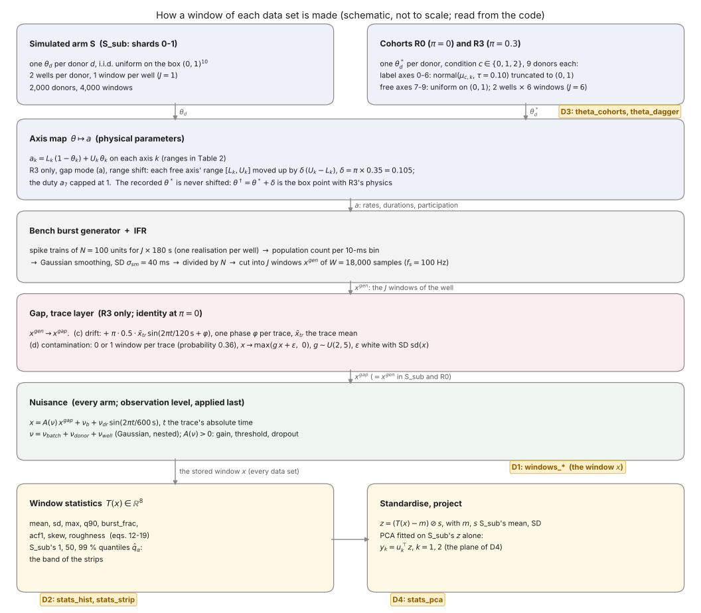

*Figure 1 -- A window of every data set passes the same five steps, and the gap's two layers act only on R3 [CODE: build_latent_bank.py, latent_sbi_simulator.py, bench_burst_provider.py, latent_gap.py, latent_nuisance.py; RUN: scripts/check08_rebuild.py] [Certain]; schematic, not to scale; the tags name the overview's figure family reading each object; made by `scripts/make_fig01_schematic.py`.*

**The parameter.** Arm S draws one parameter per donor, uniformly on the unit box, and gives it to both wells of the donor:

$$\theta_d \overset{\text{i.i.d.}}{\sim} \mathrm{U}(0,1)^{10}, \qquad d = 1, \dots, 2{,}000 \text{ in } S_{sub}. \tag{1}$$

Equation (1) says that each simulated donor's parameter $\theta_d \in \Theta$ is a fresh, independent draw, every coordinate uniform on $(0,1)$ and independent of the others; "i.i.d." (independent and identically distributed) is across donors; the two wells of a donor share $\theta_d$ exactly, so $S_{sub}$'s 4,000 windows carry 2,000 distinct parameters `[CODE: build_latent_bank.py:292-298; RUN: scripts/check02_theta.py]` [Certain]. A cohort donor of condition $c$ is drawn differently on the label axes:

$$\theta^*_{d,k} \mid c \sim \mathcal{N}(\mu_{c,k}, \tau^2) \text{ truncated to } (0,1) \text{ for each } k \in K_L, \qquad \theta^*_{d,k} \sim \mathrm{U}(0,1) \text{ for each } k \in K_F. \tag{2}$$

Equation (2) gives, for each fixed condition $c$, the distribution $q_c$ of a donor's parameter: on each label axis $k$ a normal centred at the condition's centre $\mu_{c,k}$ with SD $\tau = 0.10$, cut to the box (the cut removes little: every centre is at least 0.35 from the box's edges, 3.5 SDs); on each free axis the same uniform as arm S; all coordinates independent given $c$; the cohort fixes 9 donors per condition rather than drawing $c$, and every coordinate is finally kept a machine epsilon inside $(0,1)$ `[CODE: latent_sbi_simulator.py:198-232, build_latent_bank.py:299-305]` [Certain]. The three centres are a regular simplex scaled by 0.6 about the box's centre, every pair 0.442 apart on the label axes `[KB: SBI_decisions_and_ideas_log.md, D-120; RUN: scripts/check02_theta.py]` [Certain].

**The axis map.** Box coordinates are not physics. Each coordinate is mapped affinely onto a physical range (Table 2):

$$a_k(\theta;\, \delta) = (L_k + \delta_k w_k)(1 - \theta_k) + (U_k + \delta_k w_k)\,\theta_k, \qquad \delta_k = \begin{cases}\delta & k \in K_F\\ 0 & k \in K_L\end{cases}, \qquad a_7 \leftarrow \min(a_7, 1). \tag{3}$$

Equation (3) computes physical parameter $k$ (in the units of Table 2) from box coordinate $\theta_k$, for each fixed shift $\delta$: the convex combination of the range's two ends puts $\theta_k = 0$ at the lower end and $\theta_k = 1$ at the upper end exactly; $\delta_k w_k$ moves both ends of a free axis up by the fraction $\delta$ of its width $w_k$; the last clause caps the fragment duty $a_7$, a fraction of a burst, at 1. In arm S and R0, $\delta = 0$ and (3) is the plain affine map; in R3, $\delta = 0.35\,\pi = 0.105$ (gap mode a, the range shift), and the recorded $\theta^*$ is never shifted -- the shift lives in the map `[CODE: bench_burst_provider.py:100-131, latent_gap.py:97-104]` [Certain].

*Table 2 -- The ten axes: the physical parameter, its range $[L_k, U_k]$ and units* `[CODE: bench_burst_provider.py BENCH_AXES; bench_burst_generator.py BenchBurstParams]` [Certain].

| $k$ | name | physical parameter | $[L_k, U_k]$ | units | axis kind |
|---|---|---|---|---|---|
| 0 | burst_rate | rate of burst onsets (gamma renewal) | 0.10-0.40 | bursts/s | label |
| 1 | irregularity | log-SD of the lognormal burst durations | 0.30-0.90 | dimensionless | label |
| 2 | ibi_cv | coefficient of variation of the inter-burst intervals | 0.25-1.00 | dimensionless | label |
| 3 | n_fragments | mean number of fragments per burst | 1-4 | count | label |
| 4 | intraburst_rate | spike rate of a participating unit inside a fragment | 60-140 | spikes/s | label |
| 5 | participation_mean | mean probability that a unit takes part in a fragment | 0.45-0.80 | probability | label |
| 6 | burst_duration | median burst duration | 0.15-0.35 | s | label |
| 7 | fragment_duty | fraction of a burst covered by its fragments | 0.35-1.00 | dimensionless | free (shifted in R3, capped at 1) |
| 8 | participation_kappa | concentration of the Beta participation | 3-15 | dimensionless | free (shifted in R3) |
| 9 | background | background spike rate | 0.01-0.06 | spikes/s per unit | free (shifted in R3) |

At the three centres the label axes read, in physical units, as Table 3 lists: condition 0 bursts most often (about 52 burst onsets per 180-s window), condition 1 least often (about 37) and with the most regular bursts, condition 2 in between (about 46) with the longest bursts and the tallest plateaus -- the highest participation and intraburst rate `[RUN: scripts/check02_theta.py, part d]` [Certain].

*Table 3 -- The conditions' centres $\mu_c$ in physical units, $a_k = L_k + \mu_{c,k} w_k$ on the label axes (the free axes are uniform over their whole range in every condition), and the burst onsets per window at the centre, $a_0 T_{win}$* `[RUN: scripts/check02_theta.py, part d]` [Certain].

| condition | burst_rate (bursts/s) | irregularity | ibi_cv | n_fragments | intraburst_rate (spikes/s) | participation_mean | burst_duration (s) | onsets per 180 s |
|---|---|---|---|---|---|---|---|---|
| 0 | 0.290 | 0.664 | 0.669 | 2.50 | 95.3 | 0.588 | 0.223 | 52.2 |
| 1 | 0.205 | 0.518 | 0.540 | 2.25 | 95.7 | 0.614 | 0.247 | 36.9 |
| 2 | 0.255 | 0.618 | 0.665 | 2.75 | 109 | 0.673 | 0.280 | 45.9 |

These are the differences D1 can show by eye, and they are modest, which is what D-120 chose: "medium" separability, about two windows in three classified correctly from the eight statistics by a linear classifier in the sandbox calibration `[KB: SBI_decisions_and_ideas_log.md, D-120's Status]` [Likely].

**The generator and the IFR.** From the physical parameters the bench burst generator draws the spike times of $N = 100$ units for a whole trace, $J \times 180$ s long, with its own realisation seed per well (the two wells of a donor get different spike trains); the IFR step then counts all units' spikes in 10-ms bins, smooths the counts with a Gaussian, divides by $N$ and cuts the trace into $J$ consecutive windows:

$$x^{gen}_{j,n} = \frac{1}{N}\,\big(C \ast g_{\sigma_{sm}/\Delta t}\big)\big[\,j W + n\,\big], \qquad n = 1, \dots, W,\; j = 0, \dots, J-1. \tag{4}$$

Equation (4) computes sample $n$ of window $j$ of a trace, in spikes per unit per 10-ms bin: $C$ is the population count per bin over the whole trace (an integer sequence, indexed from 1 like the samples, its bins $[(\ell-1)\Delta t, \ell\Delta t)$ from the trace's start), $\ast$ is discrete convolution, $g_{\sigma}$ is a Gaussian kernel of SD $\sigma = \sigma_{sm}/\Delta t = 4$ bins (normalised to unit sum, so smoothing moves spikes in time without changing their number), $1/N$ turns the population count into a per-unit count, and the index $jW + n$ picks window $j$'s stretch of the trace; negative tails of the smoothing are clipped to 0, so $x^{gen} \ge 0$ `[CODE: bench_burst_provider.py:180-224; hpc/dsn/generate_burst_data.py:207-250, compute_ifr_trace]` [Certain]. Inside a fragment a participating unit fires at $a_4 = $ 60-140 spikes/s, i.e. 0.6-1.4 spikes per 10-ms bin, and a fraction $a_5 \approx$ 0.45-0.80 of the units take part, so a burst's plateau sits near $a_5 a_4 \Delta t \approx$ 0.3-1.1 spikes per unit per bin, while the background contributes $a_9 \Delta t \le 6 \times 10^{-4}$ `[OWN: eq. (4), Table 2]` [Likely] -- which is why the windows of D1 look like isolated peaks of height 0.3-1 on a floor near 0. The generator starts each trace after a burn-in of ten mean inter-burst intervals, so its burst process is close to stationary from the trace's first sample and the window index $j$ does not change the dynamics' statistics `[CODE: bench_burst_generator.py, BenchBurstParams.burn_in_intervals]` [Likely].

**The gap's trace layer (R3 only).** At $\pi > 0$ two of the gap's modes act on the whole trace $x^{gen}$ at once; at $\pi = 0$ they are the identity, so $x^{gap} = x^{gen}$ in arm S and R0 `[CODE: latent_gap.py:77-80, 158-160]` [Certain]. First the drift, gap mode c:

$$x^{gap}_{j,n} = x^{gen}_{j,n} + \pi \cdot 0.5 \cdot \bar{x}_{tr} \cdot \sin\!\big(2\pi t / P_{gap} + \varphi\big), \qquad t = j T_{win} + (n-1)\Delta t. \tag{5}$$

Equation (5) adds to every sample of a trace one slow sinusoid: its amplitude $\pi \cdot 0.5 \cdot \bar{x}_{tr}$ is $0.15$ times the trace's mean $\bar{x}_{tr}$ in R3 (so it scales with the culture's activity), its period $P_{gap} = 120$ s is shorter than a window, $\varphi \sim \mathrm{U}(0, 2\pi)$ is drawn once per trace, and $t$ is the trace's absolute time, so the sinusoid runs continuously across the window boundaries; nothing rectifies the sum, so $x^{gap}$ can dip below 0 `[CODE: latent_gap.py:162-170]` [Certain]. Then the contamination, gap mode d: with the fraction $\pi \cdot 0.2 = 0.06$ and $J = 6$, the expected count $0.36$ per trace is rounded stochastically, so a trace gets one contaminated window with probability 0.36 and none otherwise, and the chosen window becomes

$$x^{gap}_{j,\cdot} \leftarrow \max\!\big(g\, x^{gap}_{j,\cdot} + \epsilon,\; 0\big), \qquad g \sim \mathrm{U}(2, 5), \quad \epsilon_n \overset{\text{i.i.d.}}{\sim} \mathcal{N}\big(0,\, \mathrm{sd}_W(x^{gap}_{j,\cdot})^2\big). \tag{6}$$

Equation (6) replaces the whole chosen window, sample by sample: $g$ multiplies its amplitude by a factor between 2 and 5 (one draw per window), $\epsilon$ adds white noise -- independent from sample to sample, unlike everything the generator makes, which is smoothed over 4 bins -- with SD equal to the window's own SD before the contamination ($\mathrm{sd}_W$ divides by $W$, not $W - 1$: a relative difference of $3 \times 10^{-5}$, harmless), and $\max(\cdot, 0)$ sets negative values to 0, so the noise leaves a rectified, positive floor between bursts `[CODE: latent_gap.py:172-189; RUN: scripts/check04_contamination.py, part a]` [Certain]. The bank records which windows were contaminated (`contaminated`), and the overview reads that flag.

**The nuisance (every data set).** Last, every window of every arm passes an observation-level map:

$$x_{j,n} = A(\nu)\, x^{gap}_{j,n} + \nu_b + \nu_{dr} \sin\!\big(2\pi t / P_\nu\big), \qquad t = j T_{win} + (n-1)\Delta t, \tag{7}$$

$$A(\nu) = e^{\nu_{lg}}\; e^{-\kappa_\nu \nu_{thr}}\; \frac{\max\big(1,\, \mathrm{round}(n_e\,(1 - \sigma_L(\rho_0 + \nu_{do})))\big)}{n_e}, \tag{8}$$

$$\nu = \nu^{batch} + \nu^{donor} + \nu^{well}, \qquad \nu^{level} \sim \mathcal{N}\big(0, \mathrm{diag}(\sigma^2_{level})\big), \tag{9}$$

with $\sigma_{batch} = (0.10, 0.02, 0.10, 0.30, 0.02)$ and $\sigma_{donor} = \sigma_{well} = (0.05, 0.01, 0.05, 0.15, 0.01)$ in the order of $\nu$'s components. Equation (7) returns the stored window, for each fixed well (each fixed $\nu$): the gain $A(\nu) > 0$ rescales the whole trace, $\nu_b$ shifts it by a constant offset, and $\nu_{dr} \sin(2\pi t/P_\nu)$ adds a slow drift of period $P_\nu = 600$ s, in absolute trace time and with no random phase -- its sign comes from $\nu_{dr}$'s. Equation (8) assembles the gain from three multiplicative parts: $e^{\nu_{lg}}$ a log-normal gain; $e^{-\kappa_\nu \nu_{thr}}$ the fraction of events kept when the detection threshold moves by $\nu_{thr}$ ($\kappa_\nu = 0.5$); and the fraction of the $n_e = 9$ electrodes left after a dropout whose probability is the logistic function $\sigma_L$ of $\rho_0 + \nu_{do}$, $\rho_0 = -4$. Equation (9) builds a well's $\nu$ as the sum of three independent Gaussian contributions, shared by every well of a batch (8 donors), of a donor, and of the well alone, so the variances add `[CODE: latent_nuisance.py:43-212; build_latent_bank.py:312-325]` [Certain]. The sizes, over $S_{sub}$'s 4,000 wells: $\log A$ has SD 0.145 (0.137 from the configured scales), so the gain spans 0.75-1.32 in 95 % of the wells; $\nu_b$ and $\nu_{dr}$ have SD 0.024 (0.0245 configured), i.e. about two thirds of the typical window mean; the dropout leaves all 9 electrodes in 3,999 of the 4,000 wells, so in practice it never acts `[RUN: scripts/check05_drifts.py, part a]` [Certain]. Because the offset $\nu_b$ is as often negative as positive and the generator's floor between bursts is near 0, a window's floor sits below 0 in about half the wells -- the reason negative means and negative q90s occur in §3.4 `[OWN: eqs. (4), (7)]` [Likely].

**The order is the bank's.** Each of R3's 54 traces was rebuilt here from its recorded ingredients -- $\theta^*$ re-drawn in float64 from the shard's seed (its float32 copy equals the bank's), the realisation seed, the trace's random generator and $\nu$ -- through the repository's provider with the shift, the trace layer and the nuisance, in the order (3)-(7): the rebuilt windows equal the bank's to $2.3 \times 10^{-7}$, the float32 storage precision, and the contamination flags are reproduced `[RUN: scripts/check08_rebuild.py, parts a0-a]` [Certain]. So Figure 1 is not a reading of the code only; it is the bank's own recipe. What every data set shares -- the generator, the IFR, the nuisance -- and what only R3 has -- the shifted map, the trace layer -- is now fixed; the next section reads the windows that come out.

### 3.3 Reading D1: the windows

D1 answers the plainest question: what does a window look like, and does a cohort window look like an arm-S window? It draws a handful of windows, chosen by rule rather than by eye, in full and zoomed.

**What is drawn.** `windows_cohorts` shows, for each cohort and each condition, two donors drawn with the evaluation's seed (4242, through `ev_plan.seed_of`, which derives one seed per purpose from it, so each figure's draw is reproducible and independent of the others), each by the first window ($j = 0$) of its first well: 180 s, the zoomed stretch shaded; one hue per condition (pink 0, blue 1, green 2), one column per cohort (Figure 2). `windows_cohorts_zoom` shows the same twelve windows over 20 s centred on each window's maximum, the start kept inside the window (Figure 3). `windows_sim` shows six $S_{sub}$ windows drawn with the same seed, in gray, full and zoomed, each labelled with its row in the simulated bank and its donor -- ids at or above 1,000,000 are shard 1's, offset by $10^6$ so the shards never share an id (Figure 4). `windows_contaminated` shows two of R3's contaminated windows, drawn with the seed, full and zoomed (Figure 5) `[CODE: ev_dataview.py:125-165; ev_data_figures.py:124-207]` [Certain].

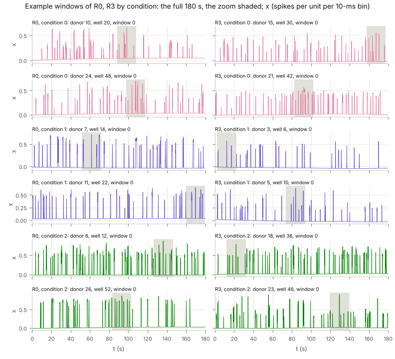

*Figure 2 -- An uncontaminated window of R0 and of R3 look alike, condition by condition: isolated burst peaks of 0.3-0.9 spikes per unit per 10-ms bin on a floor near 0 [DATA: sandbox rebuild, data_view.npz] [Certain]; two donors per condition, window 0 of the first well; the job's figure, re-drawn by `scripts/make_job_figures.py`.*

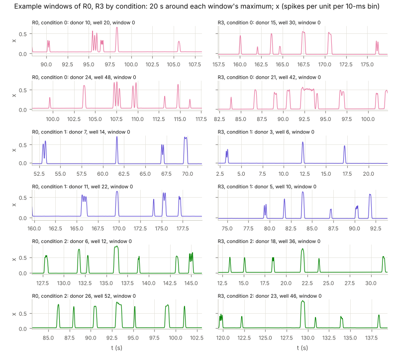

*Figure 3 -- At 20 s around the maximum a burst is a plateau of a few hundred milliseconds, often split into fragments, smooth at the 40-ms scale of the IFR's Gaussian [DATA: sandbox rebuild] [Certain]; the windows of Figure 2; re-drawn by `scripts/make_job_figures.py`.*

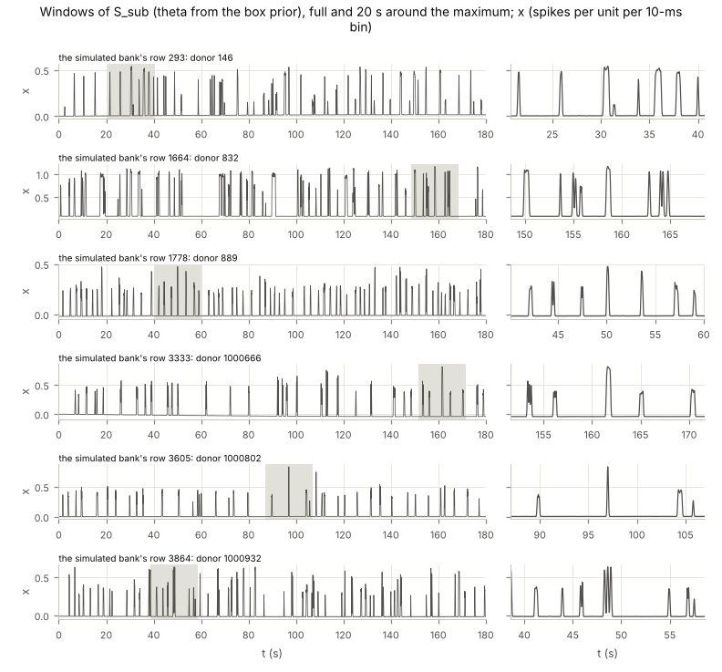

*Figure 4 -- Windows of the prior predictive vary more than the cohorts': burst rates, heights (up to 1.1 here) and fragmentation span the whole box [DATA: sandbox rebuild] [Certain]; six windows of $S_{sub}$, each one draw of eq. (1); re-drawn by `scripts/make_job_figures.py`.*

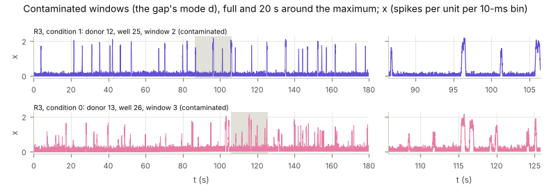

*Figure 5 -- A contaminated window has peaks of about 2 and a noisy, positive floor where the uncontaminated windows are flat [DATA: sandbox rebuild] [Certain]; R3, donors 12 and 13, windows 2 and 3, eq. (6); re-drawn by `scripts/make_job_figures.py`.*

**What to look for.** The y axis is the window's value $x_n$ in spikes per unit per 10-ms bin (Conventions). Each peak is a burst: its height is the plateau of §3.2, near $a_5 a_4 \Delta t$ times the gain $A(\nu)$; its width is the burst's duration (0.15-0.35 s at the median, longer when fragments are many); the dips inside a plateau, visible in the zoom, are the gaps between fragments `[OWN: eq. (4), Table 2]` [Likely]. The floor between bursts is the nuisance's offset $\nu_b$ plus its slow drift, because the generator's own floor is below $10^{-3}$: a floor slightly below 0, as in R0's condition 1, donor 11, is a negative $\nu_b$, not an error `[OWN: eqs. (4), (7); RUN: scripts/check05_drifts.py]` [Likely]. A slow tilt of the floor over the 180 s is the nuisance drift (amplitude about 0.02, period 600 s), plus in R3 the gap's drift (amplitude about 0.006, period 120 s); by eye the two cannot be told apart, and both are small beside a burst `[RUN: scripts/check05_drifts.py, parts a-b]` [Certain].

**What is expected.** Conditions differ in the rate and length of bursts (§3.2's centres): condition 1 bursts least often (about 37 onsets per window at its centre against 46 and 52), condition 2 has the tallest plateaus. But each condition spreads with $\tau = 0.10$ about its centre, so two donors of one condition can differ as much as two conditions do, and D1 is not where the conditions are told apart `[RUN: scripts/check02_theta.py, part d; OWN]` [Likely]. R0 and R3 are expected to look alike outside the contaminated windows, and they do: two of R3's six example donors, 3 and 23, have $\theta^\dagger$ outside the box (§3.5), and nothing in their windows marks them `[DATA: sandbox rebuild]` [Certain] -- the first sign of §3.7's conclusion that the range shift is invisible in the data. The $S_{sub}$ windows of Figure 4 vary more than any cohort's: they come from the whole box, the cohorts from three concentrated conditions.

**What would signal a problem.** A window whose floor is far from 0 (beyond about $\pm 0.1$, four nuisance SDs), a window with no bursts in 180 s, an uncontaminated cohort window with a noisy floor like Figure 5's, or a contaminated window that looks clean: each would mean the bank or the flag is not what §3.2 describes `[OWN]` [Likely]. None occurs in the sandbox rebuild's figures. D1 shows twelve cohort windows of 648 and six of 4,000; the next section summarises every window, so that nothing rests on a handful of examples.

### 3.4 Reading D2: the eight statistics against the prior predictive

D2 replaces each window by eight numbers and compares the cohorts' numbers with $S_{sub}$'s distribution of the same numbers. Three things are needed to read it: what the comparison is against (the prior predictive), what the eight numbers measure, and what the cohorts' distributions are expected to look like.

**Against what: the prior predictive.** A window of arm S is a draw of

$$P_S(\mathrm{d}x) = \int_{\Theta} p(\mathrm{d}x \mid \theta)\; \mathrm{d}\theta, \qquad p(\mathrm{d}x \mid \theta) = \int p(\mathrm{d}x \mid \theta, \nu)\; p(\mathrm{d}\nu), \tag{10}$$

and a window of cohort $D \in \{\text{R0}, \text{R3}\}$ is a draw of

$$P_D(\mathrm{d}x) = \frac{1}{3} \sum_{c=0}^{2} \int_{\Theta} p^{(\pi_D)}(\mathrm{d}x \mid \theta)\; q_c(\mathrm{d}\theta). \tag{11}$$

Equation (10) defines the prior predictive $P_S$, a probability distribution on the window space $\mathcal{X}$: $p(\mathrm{d}x \mid \theta, \nu)$ is the law of a window given the parameter and the well's nuisance, its randomness being the spike trains; integrating over $p(\mathrm{d}\nu)$, the marginal law of a well's $\nu$ from eq. (9), gives the law given $\theta$ alone; integrating over $\theta$ with the box prior's density, which is 1 on $\Theta$, gives the law of a window whose parameter is unknown and uniform. Equation (11) is the same construction for a cohort: the box prior is replaced by the mixture of the three conditions' distributions $q_c$ of eq. (2), each with weight $1/3$ (9 of 27 donors), and the window law by $p^{(\pi_D)}$, the simulator with cohort $D$'s gap, averaged over the window's index $j \in \{0, \dots, 5\}$ and, for R3, over the trace layer's draws -- for R0, whose $\pi_D = 0$, the same generator, IFR and nuisance as $p$, differing only through $j$ (§3.7) `[OWN: eqs. (1)-(9)]` [Certain]. Both are derivation-only: no code evaluates them. What the code holds is $S_{sub}$, 4,000 windows each distributed as $P_S$, though not independent of each other (the two wells of a donor share $\theta_d$ and $\nu^{donor}$; 16 wells share $\nu^{batch}$). So $S_{sub}$'s histograms and quantiles are estimates of $P_S$'s, computed from a dependent sample `[CODE: build_latent_bank.py:292-325]` [Certain]. Equation (11) says, before any figure: R0 is not expected to look like $S_{sub}$, even with no gap -- its parameters are concentrated where (2) puts them -- but it is expected to stay inside $S_{sub}$'s range, because every $q_c$ puts its mass inside the box where the box prior also does, and the window law given $\theta$ is the same (with the window-index caveat of §3.7) `[OWN: eqs. (10)-(11)]` [Likely].

**The eight statistics.** For a window $x \in \mathcal{X}$, with $\xi_n = (x_n - T_1(x)) / T_2(x)$ the standardised window:

$$T_1(x) = \mathrm{mean} = \frac{1}{W}\sum_{n=1}^{W} x_n \tag{12}$$

$$T_2(x) = \mathrm{sd} = \Big(\frac{1}{W-1}\sum_{n=1}^{W} \big(x_n - T_1(x)\big)^2\Big)^{1/2} + 10^{-8} \tag{13}$$

$$T_3(x) = \mathrm{max} = \max_{1 \le n \le W} x_n \tag{14}$$

$$T_4(x) = \mathrm{q90} = Q_{0.9}(x_1, \dots, x_W) \tag{15}$$

$$T_5(x) = \mathrm{burst\_frac} = \frac{1}{W}\sum_{n=1}^{W} \mathbb{1}\big[x_n > T_1(x) + T_2(x)\big] \tag{16}$$

$$T_6(x) = \mathrm{acf1} = \frac{1}{W-1}\sum_{n=1}^{W-1} \xi_n\, \xi_{n+1} \tag{17}$$

$$T_7(x) = \mathrm{skew} = \frac{1}{W}\sum_{n=1}^{W} \xi_n^3 \tag{18}$$

$$T_8(x) = \mathrm{roughness} = \frac{1}{W-1}\sum_{n=1}^{W-1} \lvert x_{n+1} - x_n \rvert \tag{19}$$

Each returns one real number per window, all eight together the vector $T(x) \in \mathcal{T} = \mathbb{R}^8$; they are block 19's `fixed_stats`, which calls the joint stack's `FixedStatsSummary` -- the fixed summary that the reference arm A_ref uses in place of a learned encoder -- computed in float32 by torch; numpy recomputations in float64 agree to $2 \times 10^{-6}$ on every window of R0, R3 and 200 of $S_{sub}$ `[CODE: hpc/joint/stage3/run_joint_arms.py:78-114, ev_simulate.py:35-48; RUN: scripts/check01_statistics.py]` [Certain]. Read one at a time:

- **mean** (12), in spikes per unit per bin: the average activity, $f_s T_1$ in spikes per unit per second (3.5 spikes/s at $S_{sub}$'s median); it carries the nuisance offset $\nu_b$ whole, which is why it can be negative.
- **sd** (13), same units: the spread of the window's samples, dominated by the bursts; $W - 1$ is the sample-SD divisor; $10^{-8}$ keeps the division in $\xi_n$ finite for a flat window and is negligible otherwise.
- **max** (14), same units: the tallest plateau, times the gain.
- **q90** (15), same units: the level exceeded by 10 % of the samples, $Q_{0.9}$ the empirical quantile with linear interpolation. When bursts cover less than 10 % of the window, q90 is a floor value, hence negative when $\nu_b$ is.
- **burst_frac** (16), dimensionless: the fraction of samples above the window's own mean plus its own SD -- roughly the fraction of time in bursts, with a threshold set by the window itself.
- **acf1** (17), dimensionless: the mean product of neighbouring standardised samples over the $W - 1$ pairs; since $T_2^2$ carries the same divisor $W - 1$, it equals the usual lag-1 autocorrelation estimator $\sum_{n=1}^{W-1}(x_n - T_1)(x_{n+1} - T_1) / \sum_{n=1}^{W}(x_n - T_1)^2$, up to the $10^{-8}$. The Gaussian smoothing over 4 bins makes neighbouring samples nearly equal, so acf1 sits near 0.996 `[DATA: sandbox rebuild]`; anything that adds independent sample-to-sample noise lowers it.
- **skew** (18), dimensionless: the third standardised moment; large and positive because a bursty window is mostly floor with rare tall excursions.
- **roughness** (19), spikes per unit per bin: the mean absolute step between neighbouring samples, small (about 0.003) for a smoothed trace; white noise raises it.

One property organises the reading. Under a positive affine map of the whole window, $x \mapsto A x + b$ with constants $A > 0$ and $b$, every $\xi_n$ is unchanged (the mean becomes $A T_1 + b$, the SD $A T_2$, up to the $10^{-8}$), so burst_frac, acf1 and skew are unchanged, while mean, max and q90 become $A T + b$, and sd and roughness become $A T$ `[OWN: eqs. (12)-(19), one line each]` [Certain]. The nuisance of eq. (7) is such a map apart from its drift, so the nuisance's gain and offset widen the distributions of five statistics and leave three almost untouched; and the contamination's factor $g$ is such a map too, so on burst_frac, acf1 and skew eq. (6) acts only through its noise and its rectification.

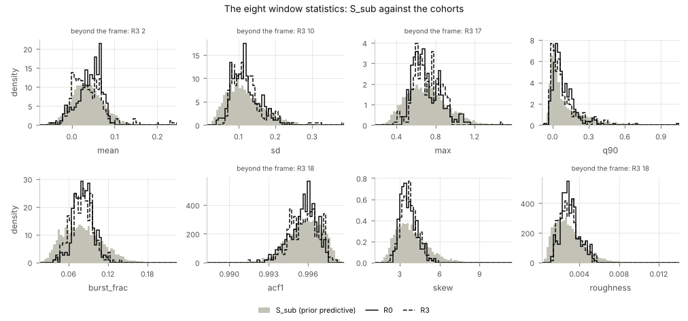

*Figure 6 -- The cohorts' densities lie inside $S_{sub}$'s and are taller and narrower; only R3 has windows beyond the frame, all contaminated [DATA: sandbox rebuild; RUN: scripts/check03_tails.py] [Certain]; each panel one statistic, 60 bins over its frame, heights eq. (20); re-drawn by `scripts/make_job_figures.py`.*

**Reading `stats_hist` (Figure 6).** Each panel is one statistic $T_i$ on its frame $[F^{lo}_i, F^{hi}_i]$ -- the range of $S_{sub}$'s and the cohorts' uncontaminated windows, widened by 2 % on each side -- cut into 60 equal bins. The gray bars are $S_{sub}$, the lines R0 (solid) and R3 (dashed). The heights are densities:

$$h_b = \frac{\#\{x \in D : T_i(x) \in \text{bin } b\}}{n_D \; |\text{bin } b|}, \tag{20}$$

Equation (20) gives the height over bin $b$ of data set $D$'s histogram of statistic $i$: the number of $D$'s windows whose $T_i$ falls in the bin, divided by all of $D$'s windows $n_D$ (inside the frame or not) and by the bin's width $|\text{bin } b|$, so the area under $D$'s histogram is the fraction of $D$'s windows inside the frame, and data sets of 4,000 and 324 windows share one axis. R3's areas fall below 1 by its windows beyond the frame -- $1 - 18/324 = 0.944$ on acf1 and roughness, where all 18 contaminated windows are beyond it -- and the panel's title counts them `[CODE: ev_dataview.py:117-122; RUN: scripts/check03_tails.py, part d]` [Certain]. Every window beyond a frame is a contaminated one, by construction of the frame. What is expected from eq. (11) is what Figure 6 shows: the cohorts' histograms sit inside the gray, taller and narrower. The interquartile range of R0's windows is 0.46-0.79 of $S_{sub}$'s, statistic by statistic, and of R3's uncontaminated windows 0.49-0.95 `[RUN: scripts/check03_tails.py, part c]` [Certain]. The narrowing follows from the parameters: on the seven label axes a cohort's $\theta^*$ has SD $\tau = 0.10$ about a centre, a third of the uniform's $1/\sqrt{12} = 0.29$ `[OWN: eq. (2)]` [Likely].

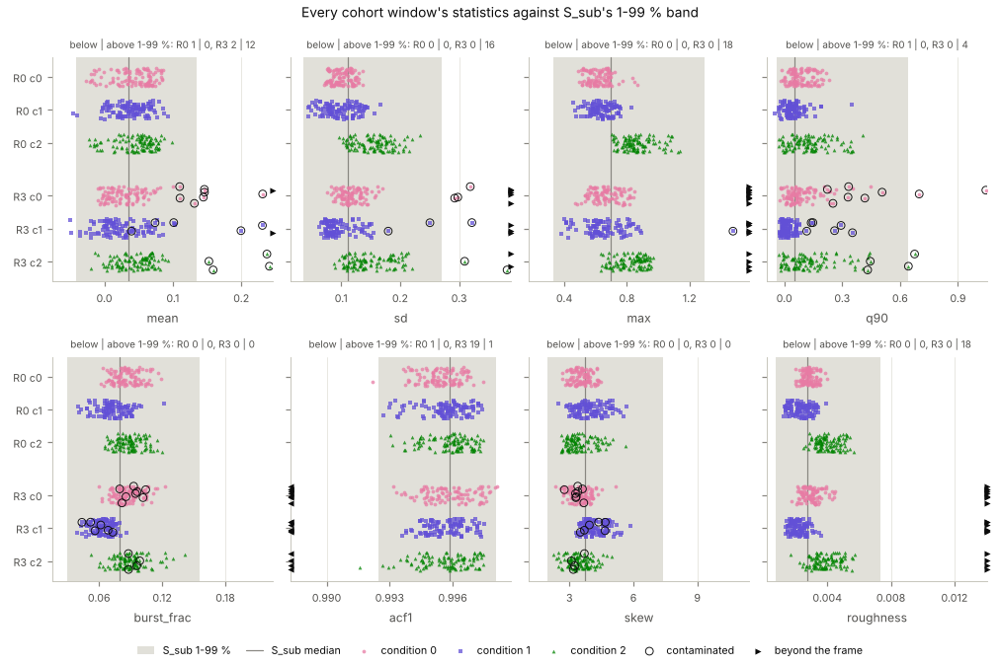

*Figure 7 -- Uncontaminated cohort windows fall outside $S_{sub}$'s 1-99 % band 3 (R0) and 4 (R3) times in 16 tails, where windows exchangeable with $S_{sub}$ would fall about 50 times; contaminated windows fall outside on acf1 and roughness every time [DATA: sandbox rebuild; RUN: scripts/check03_tails.py] [Certain]; rows cohort x condition, jittered; re-drawn by `scripts/make_job_figures.py`.*

**Reading `stats_strip` (Figure 7).** Each panel is one statistic; each point one cohort window, in a row for its cohort and condition, jittered vertically (the jitter carries no information); the shaded band is $S_{sub}$'s $[\hat q_{0.01}, \hat q_{0.99}]$ and the line its median $\hat q_{0.5}$ (Table 4); contaminated windows are ringed; windows beyond the frame are drawn as arrowheads at its edge. The panel's title counts each cohort's windows below and above the band. The count has a reference value. For a window drawn from $P_S$ and a continuous statistic, $\Pr\big(T_i(x) < q_{0.01,i}\big) = 0.01$ by the definition of a quantile `[TXT]` [Certain], so a cohort of $n_D$ windows exchangeable with $S_{sub}$ would put on average

$$\mathbb{E}\big[\#\{x \in D : T_i(x) < \hat q_{0.01,i}\}\big] \approx 0.01\, n_D = 3.24 \quad (n_D = 324) \tag{21}$$

windows below the band on each statistic, and as many above. Equation (21) counts, in expectation over repeated cohorts, the windows below $S_{sub}$'s estimated 1 % quantile $\hat q_{0.01,i}$; the "$\approx$" is the step from the distribution's quantile $q_{0.01,i}$ to its estimate from 4,000 dependent windows; the windows of one donor are correlated, which widens the count's spread around 3.24 but not its mean `[OWN: eq. (21)]` [Likely]. Over the 16 tails (8 statistics, 2 sides) that is about 52 for R0 and 49 for R3's 306 uncontaminated windows. Observed: 3 for R0 (mean, q90 and acf1 below, once each) and 4 for R3's uncontaminated windows (mean below twice, acf1 below once and above once) `[RUN: scripts/check03_tails.py, part b]` [Certain]. The cohorts are far *less* extreme than $S_{sub}$, as their concentrated parameters predict; a count near or above the exchangeable value on uncontaminated windows would be the thing to worry about.

*Table 4 -- $S_{sub}$'s quantiles $\hat q_{0.01}$, $\hat q_{0.5}$, $\hat q_{0.99}$, and its mean $m$ and SD $s$, per statistic* `[RUN: scripts/check03_tails.py, part a; scripts/check07_pca.py, part a]` [Certain].

| statistic | $\hat q_{0.01}$ | $\hat q_{0.5}$ | $\hat q_{0.99}$ | $m$ | $s$ |
|---|---|---|---|---|---|
| mean | -0.0407 | 0.0352 | 0.1343 | 0.0378 | 0.0371 |
| sd | 0.0362 | 0.1109 | 0.2706 | 0.1191 | 0.0522 |
| max | 0.328 | 0.695 | 1.296 | 0.711 | 0.213 |
| q90 | -0.0406 | 0.0507 | 0.6418 | 0.114 | 0.154 |
| burst_frac | 0.0293 | 0.0791 | 0.1552 | 0.0812 | 0.0291 |
| acf1 | 0.99245 | 0.99586 | 0.99805 | 0.99577 | 0.00130 |
| skew | 1.95 | 3.71 | 7.37 | 3.90 | 1.19 |
| roughness | 0.00072 | 0.00271 | 0.00732 | 0.00296 | 0.00148 |

**The contamination's signature.** R3's 18 contaminated windows are below the band on acf1 and above it on roughness every time, above it on max every time, on sd 16 times, on mean 12 times, on q90 4 times, and never outside on burst_frac or skew `[RUN: scripts/check03_tails.py, part b]` [Certain]. Equation (6) explains the pattern. The white noise $\epsilon$ is independent from sample to sample while the window is smooth over 4 bins, so it decorrelates neighbours, lowering acf1, and adds steps of typical size $\mathbb{E}\lvert \epsilon_{n+1} - \epsilon_n \rvert = 2\,\mathrm{sd}_W(x^{gap})/\sqrt{\pi} \approx 1.1\, \mathrm{sd}_W(x^{gap})$ before the gain and the rectification, raising roughness from about 0.003 to about 0.05-0.1 (less than $1.1\,\mathrm{sd}_W$ because the rectification clips half of the floor's noise) `[OWN: eq. (6); TXT: the mean absolute value of a normal]` [Likely]; the factor $g$ multiplies max, sd and, through the rectified floor, mean; burst_frac and skew are untouched by $g$ (the affine invariance above) and barely moved by the noise. Applying eq. (6) here to each of R0's 324 windows -- nuisance inverted with the bank's $\nu$, eq. (6), nuisance re-applied -- reproduces it: median changes of $-27.8\, s_{acf1}$ and $+48.6\, s_{rough}$, every contaminated R0 window below the band on acf1 and above it on roughness, 99 % above on max, 79 % on sd, 69 % on mean, 10 % on q90, none on burst_frac or skew -- against R3's 100 %, 100 %, 100 %, 89 %, 67 %, 22 %, 0, 0 (Figure 8) `[RUN: scripts/check04_contamination.py, part b]` [Certain].

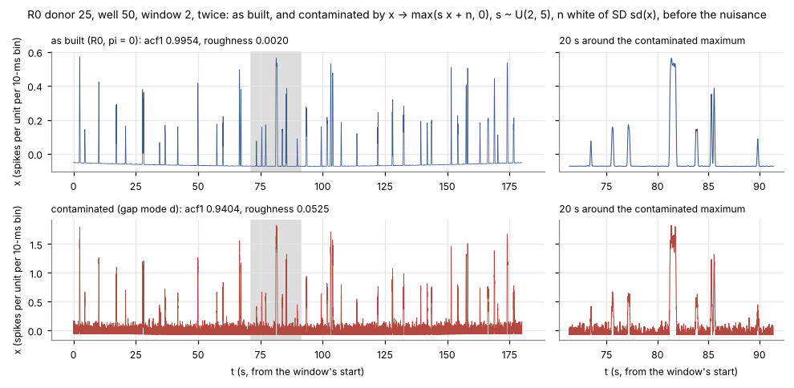

*Figure 8 -- The same window before and after eq. (6): peaks up 2-5 fold, a noisy floor, acf1 from 0.9954 to 0.9404 and roughness from 0.0020 to 0.0525 [RUN: scripts/check04_contamination.py] [Certain]; R0, donor 25, well 50, window 2, contaminated here with seed 20261112, not a window of R3; plotted by `scripts/check04_contamination.py`.*

**What would signal a problem.** On D2: uncontaminated cohort windows outside the band at a rate near eq. (21)'s or above it; a cohort histogram with mass where $S_{sub}$ has none; a contaminated window inside the band on acf1 or roughness; or R0 with any window beyond a frame. Each would mean that a cohort's windows are not a draw of eq. (11) as §3.2 builds it `[OWN]` [Likely]. None occurs in the sandbox rebuild. What D2 cannot say is which parameters made a window what it is; that is D3's subject.

### 3.5 Reading D3: the cohorts' parameters, $\theta^*$ and $\theta^\dagger$

D3 leaves the windows and shows the cohorts' parameters on the box $\Theta$, where arm S's prior is uniform: what the cohorts' donors are, and, for R3, which parameter their windows actually correspond to.

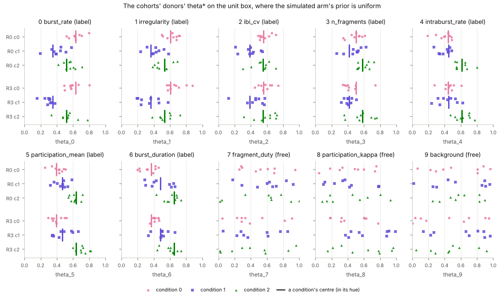

*Figure 9 -- On the label axes each condition's donors cluster about its centre with SD about $\tau = 0.10$; on the free axes they spread uniformly, as in arm S [DATA: sandbox rebuild; RUN: scripts/check02_theta.py] [Certain]; each point one donor's $\theta^*_{d,k}$, rows cohort x condition, jittered; bars the centres $\mu_{c,k}$; re-drawn by `scripts/make_job_figures.py`.*

**Reading `theta_cohorts` (Figure 9).** One panel per axis $k$, the axis's name and kind in its title, the box's coordinate $\theta_k \in (0,1)$ on the x axis. Each point is one donor's $\theta^*_{d,k}$ (27 per cohort), its row the cohort and condition; a bar marks the condition's centre $\mu_{c,k}$ on a label axis. Expected from eq. (2): on axes 0-6 the points of a condition gather about its bar, and the three bars are distinct, in a different order from axis to axis (the simplex's geometry); on axes 7-9 there are no bars and the points spread over the whole interval. Measured: the 189 deviations $\theta^*_{d,k} - \mu_{c(d),k}$ of a cohort (27 donors x 7 axes) have SD 0.097 in R0 (95 % interval 0.088-0.108) and 0.106 in R3 (0.0965-0.118), both consistent with $\tau = 0.10$; on the free axes a Kolmogorov-Smirnov test against $\mathrm{U}(0,1)$ gives p-values 0.16-0.87; and $S_{sub}$'s 2,000 parameters are uniform on all ten axes (p-values 0.08-0.89) `[RUN: scripts/check02_theta.py, parts a-c]` [Certain]. The conditions overlap on every single axis -- a donor's coordinate on one axis rarely names its condition -- which is why separability is "medium": the conditions are told apart by the seven axes together `[DATA: sandbox rebuild; KB: SBI_decisions_and_ideas_log.md, D-120]` [Likely].

**Theta-dagger.** In R3 the recorded $\theta^*$ is not the parameter of arm S that produces R3's physics: the range shift of eq. (3) has moved the free axes' physics up. The pseudo-true parameter undoes the shift in box coordinates:

$$\theta^\dagger_{d,k} = \begin{cases} \theta^*_{d,k} & k \in K_L \\ \theta^*_{d,k} + \delta & k \in \{8, 9\} \\ \min\big(\theta^*_{d,7} + \delta,\; (1 - L_7)/w_7\big) & k = 7 \end{cases} \qquad \text{so that} \qquad a(\theta^\dagger_d;\, 0) = a(\theta^*_d;\, \delta). \tag{22}$$

Equation (22) computes, for each R3 donor, the box coordinates $\theta^\dagger_d$ whose physical parameters under arm S's unshifted map equal the donor's under R3's shifted map: the label axes are not shifted and stay; the free axes move by $\delta = 0.105$; on the duty axis the cap of eq. (3) at duty 1 becomes the cap $(1 - L_7)/w_7 = 1$ in box units, because $U_7 = 1$. The identity on the right holds by the affine form of eq. (3) and was checked: the two maps agree to $2 \times 10^{-16}$ for all 27 donors, inside the box and, with the unshifted map extended affinely, outside it `[CODE: ev_data.py:106-117; RUN: scripts/check08_rebuild.py, part b]` [Certain]. For a donor inside the box, then, arm S at $\theta^\dagger_d$ generates exactly the distribution of windows R3's generator gives the donor's window 0 with gap mode a alone, since the generator, the IFR and the nuisance are shared (at later windows the nuisance drift's phase differs, §3.7) `[OWN: eqs. (3), (7), (22)]` [Likely]: the range shift relabels the truth rather than changing the data. That is why the evaluation scores R3 against $\theta^\dagger$ (the data set `R3dag`, "R3 against theta-dagger") as well as against $\theta^*$ `[CODE: ev_metrics.py:9, ev_figures.py:71]` [Certain].

**How many donors leave the box.** $\theta^\dagger_d$ is in the open box exactly when $\theta^*_{d,k} + \delta < 1$ on all three free axes (the label axes stay inside; nothing goes below 0). With the free axes independent and uniform, eq. (2),

$$\Pr\big(\theta^\dagger_d \in \Theta\big) = (1 - \delta)^3 = 0.895^3 = 0.717, \tag{23}$$

Equation (23) gives the probability that one R3 donor's pseudo-true parameter stays in the open box: each free coordinate must be below $1 - \delta$, which a uniform coordinate is with probability $1 - \delta$, and the three are independent, so the probabilities multiply. Over 27 independent donors the count in the box is binomial with mean 19.4 and SD 2.3 (95 % interval 15-24); per free axis the donors at or beyond 1 are binomial with mean $27\delta = 2.8$ `[OWN: eqs. (2), (22); RUN: scripts/check06_theta_dagger.py]` [Certain]. Observed: 17 donors in the box (a cumulative probability of 0.21, unremarkable), with 2, 4 and 5 at or beyond 1 on axes 7, 8 and 9 and one donor beyond on two axes `[RUN: scripts/check06_theta_dagger.py]` [Certain].

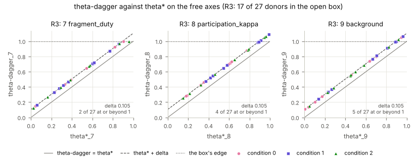

*Figure 10 -- $\theta^\dagger$ is $\theta^*$ moved up by $\delta = 0.105$ on each free axis, the duty capped at 1; 10 of R3's 27 donors reach or pass the box's edge [DATA: sandbox rebuild; RUN: scripts/check06_theta_dagger.py] [Certain]; one point per donor; solid line $\theta^\dagger = \theta^*$, dashed $\theta^* + \delta$, dotted the box's edge; re-drawn by `scripts/make_job_figures.py`.*

**Reading `theta_dagger` (Figure 10).** One panel per free axis; x is $\theta^*_{d,k}$, y is $\theta^\dagger_{d,k}$. Every point lies on the dashed line $\theta^* + \delta$, except on the duty axis, where the points with $\theta^*_7 > 1 - \delta$ sit on the dotted line at 1 (the cap); the panel's note counts the donors at or beyond 1. A point off the dashed line (other than at the cap) would mean the evaluation's $\theta^\dagger$ is not eq. (22). Being out of the box is a prior misspecification in the sense of the practical guide: the data come from parameters to which arm S's prior gives no mass, and neural SBI is reported to behave erratically there rather than returning the boundary or a broad posterior `[KB: Simulation Based Inference A Practical Guide.pdf, §3.1, Figure 4]` [Certain] -- the guide's statement concerns neural SBI methods in general and its examples are low-dimensional; whether it holds for these ensembles on these 10 donors is what the posterior evaluation measures, not this document `[OWN]` [Likely]. D3 says where the cohorts' truths lie; it says nothing about how far apart their windows are in the statistics, which is D4's subject.

### 3.6 Reading D4: the principal components of the statistics

D2 reads the statistics one at a time; D4 reads all eight together, as points in a plane. Two choices make the picture interpretable -- the statistics are standardised, and the plane is fitted on $S_{sub}$ alone -- and each is checked below.

**Standardisation.** The eight statistics have different units and spreads differing by three orders of magnitude (Table 4: $s_{acf1} = 0.0013$, $s_{skew} = 1.19$). A principal component analysis maximises variance, so on the raw statistics it would describe whichever statistic varies most in its own units. Each statistic is therefore measured in units of its own spread over $S_{sub}$:

$$z(x) = \big(T(x) - m\big) \oslash s, \qquad m = \frac{1}{n_S}\sum_{x \in S_{sub}} T(x), \quad s_i = \Big(\frac{1}{n_S - 1}\sum_{x \in S_{sub}} \big(T_i(x) - m_i\big)^2\Big)^{1/2}. \tag{24}$$

Equation (24) returns, for each window $x$ of any data set, the vector $z(x) \in \mathbb{R}^8$ of its statistics measured from $S_{sub}$'s mean $m$ in units of $S_{sub}$'s SD $s$, statistic by statistic ($\oslash$ is element-wise division, $n_S = 4{,}000$). $m$ and $s$ are numbers computed from $S_{sub}$ (computed level), estimates of $P_S$'s mean and SD, not those moments themselves; the same $m$ and $s$ standardise every data set, so a cohort window's $z$ says how far it lies from $S_{sub}$'s centre in units of $S_{sub}$'s spread -- the estimates, from 4,000 windows, of the prior predictive's centre and spread `[CODE: ev_dataview.py:88-97; RUN: scripts/check07_pca.py, part a]` [Certain]. Without it, the first principal component of $S_{sub}$'s raw statistics carries 96 % of the variance and is skew alone (loading 0.995) `[RUN: scripts/check07_pca.py, part b]` [Certain]: a PCA of units, not of windows. On standardised variables the covariance $\hat\Sigma$ is the correlation matrix of $T$, the usual choice when variables have different units `[TXT]` [Likely].

**The plane.** The directions are $S_{sub}$'s:

$$\hat\Sigma\, u_r = \lambda_r u_r, \quad \lambda_1 \ge \lambda_2 \ge \dots, \qquad y_r(x) = u_r^\top \big(z(x) - \bar z_S\big), \quad r \in \{1, 2\}, \tag{25}$$

Equation (25) defines the two coordinates D4 plots: $\hat\Sigma$ is $S_{sub}$'s sample covariance of $z$, an $8 \times 8$ matrix; $u_1, u_2$ are its eigenvectors with the two largest eigenvalues $\lambda_1, \lambda_2$ -- the directions along which $S_{sub}$'s standardised statistics vary most, unit vectors in $\mathbb{R}^8$ fixed up to sign; $\bar z_S$, $S_{sub}$'s mean of $z$, is 0 to $10^{-16}$ by eq. (24), so $y_r(x)$ is simply the projection of $z(x)$ on $u_r$, in units of $s$ (scikit-learn's `PCA(n_components=2)`, which computes the eigenvectors by a singular value decomposition of the centred data). The plane is a linear image of $\mathcal{T}$: $(y_1, y_2) \in \mathbb{R}^2$ `[CODE: ev_dataview.py:100-104; RUN: scripts/check07_pca.py, part a]` [Certain]. The explained variance ratios are $\lambda_1 / \sum_{r=1}^{8} \lambda_r = 59\,\%$ and $\lambda_2 / \sum_{r=1}^{8} \lambda_r = 17\,\%$, the sums running over all eight eigenvalues ($\sum_{r=1}^{8} \lambda_r = 8$, the trace of a correlation matrix): three quarters of $S_{sub}$'s standardised variability lies in this plane `[DATA: sandbox rebuild]` [Certain].

**The loadings.** $u_1$ weighs every statistic with the same sign except skew: mean 0.34, sd 0.41, max 0.25, q90 0.41, burst_frac 0.38, acf1 0.20, roughness 0.41, skew $-0.37$; $u_2$ puts max (0.70), skew (0.40) and sd (0.29) against burst_frac ($-0.42$) and q90 ($-0.16$), the rest small (mean 0.09, roughness 0.17, acf1 $-0.12$) `[DATA: sandbox rebuild; RUN: scripts/check07_pca.py, part a]` [Certain]. Read as physiology: a window high on $y_1$ is active, variable and busy -- frequent, broad bursts -- and less skewed, because a window with more burst time is less dominated by rare excursions, so $y_1$ reads as overall burst activity; a window high on $y_2$ has tall, rare peaks and one low on it frequent, lower ones, so $y_2$ reads as peakiness `[OWN: the loadings, eqs. (12)-(19)]` [Likely]. The signs of $u_1$ and $u_2$ are arbitrary (an eigenvector is defined up to sign), so "high" and "low" are defined by these loadings, not by any convention.

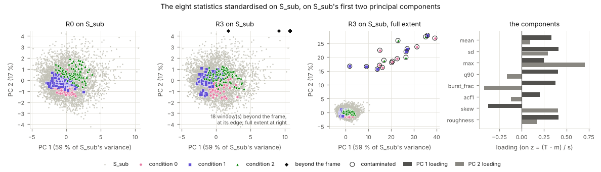

*Figure 11 -- R0's windows and R3's uncontaminated windows lie inside $S_{sub}$'s cloud on its first two principal components, the conditions partly separated; R3's contaminated windows lie 15-28 units of $s$ up on $y_2$, far off it [DATA: sandbox rebuild; RUN: scripts/check07_pca.py] [Certain]; the plane fitted on $S_{sub}$ alone, eqs. (24)-(25); re-drawn by `scripts/make_job_figures.py`.*

**Reading `stats_pca` (Figure 11).** Four panels: R0's windows on $S_{sub}$'s cloud (gray); R3's on the same cloud, the frame $S_{sub}$'s and the uncontaminated windows', so the windows beyond it are drawn as diamonds at its edge and counted in a note; R3 at full extent, where the contaminated windows (ringed) appear where they are; and the loadings as bars. Expected: the cohorts inside the cloud, each condition in its own region of it but overlapping, because the conditions differ in activity and peakiness without separating. The figure shows it: condition 2 toward higher $y_1$, condition 1 toward lower $y_1$, condition 0 toward lower $y_2$, the three regions overlapping `[DATA: sandbox rebuild, read from Figure 11]` [Likely] (read by eye, not measured). $S_{sub}$'s cloud spans $y_1$ from $-5.0$ to $10.4$ and $y_2$ from $-4.2$ to $4.3$; R3's contaminated windows sit at $y_1$ from 1.7 to 39.2 and $y_2$ from 15.6 to 27.8, nowhere near it `[RUN: scripts/check07_pca.py, part c]` [Certain]. Their large $y_2$ is the sum of loadings times standardised changes: with check 04's median changes, max $0.70 \times 8.7$, roughness $0.17 \times 48.6$ and acf1 $(-0.12) \times (-27.8)$ add up to about 18 `[OWN: eq. (25); RUN: scripts/check04_contamination.py]` [Likely].

**Why the plane is fitted on $S_{sub}$ alone.** The principal components are defined by the data set they are computed from `[ABS: PMID 26953178 -- abstract only, flagged]` [Likely], so pooling the cohorts into the fit would make the cohorts change the axes they are judged on. Fitted on $S_{sub}$ with all of R3, the plane turns by $69.6°$ and $10.3°$ (its principal angles to $S_{sub}$'s plane), its first component becomes the direction of the 18 contaminated windows (70 % of the pooled variance), and $S_{sub}$ collapses to a thin strip; fitted on $S_{sub}$ with R3's 306 uncontaminated windows, it moves by $0.9°$ and $0.2°$ (Figure 12) `[RUN: scripts/check07_pca.py, part c]` [Certain]. With the reference fitted alone, the plane is the prior predictive's, and a cohort's displacement is measured against it rather than absorbed into it. The cost: a discrepancy orthogonal to $S_{sub}$'s first two directions is invisible in D4 -- the other 24 % of $S_{sub}$'s standardised variance, and any direction $S_{sub}$ does not vary in at all `[OWN: eq. (25)]` [Likely]; D2's eight panels still see every statistic one at a time.

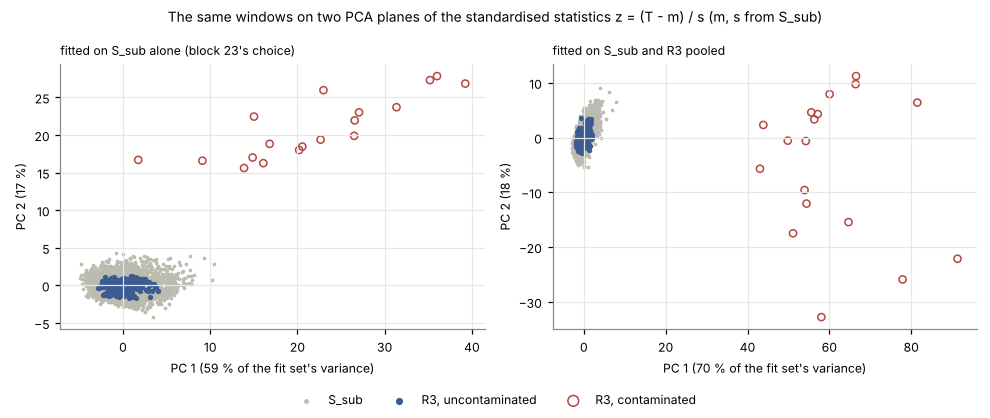

*Figure 12 -- The same windows on two planes: fitted on $S_{sub}$ alone, R3's contaminated windows stand apart and $S_{sub}$ keeps its shape; fitted on $S_{sub}$ and R3 pooled, the plane turns by about 70° toward the contaminated windows and $S_{sub}$ collapses [RUN: scripts/check07_pca.py] [Certain]; eqs. (24)-(25), seed 4242; plotted by `scripts/check07_pca.py`.*

D1-D4 have now each been read on their own terms. What they add up to -- what of R3's gap the overview sees and what it cannot -- is the last section's subject.

### 3.7 What the overview can and cannot show

The overview is a prior predictive check, the simplest one: histograms of summary statistics, checked for whether the observed data fall within the covered ranges -- quick, and liable to miss higher-order discrepancies, as the practical guide says `[KB: Simulation Based Inference A Practical Guide.pdf, §3.4]` [Certain]. Here the three gap modes give a controlled test of what it sees, because each mode's effect on the statistics can be computed.

**Contamination (mode d): seen.** Every contaminated window is outside $S_{sub}$'s range on acf1 and roughness, and far off $S_{sub}$'s cloud in D4, for the reason of eq. (6): white noise is something the smoothed generator never makes `[RUN: scripts/check03_tails.py; scripts/check04_contamination.py; scripts/check07_pca.py]` [Certain]. This is a misspecification in the guide's sense -- the simulator cannot produce these windows at any parameter -- and D2 locates it to two statistics.

**The gap's drift (mode c): not seen.** Its amplitude is 0.15 times the trace mean, a median of 0.006 over R3's 36 uncontaminated traces, a quarter of the median nuisance drift amplitude $\lvert \nu_{dr} \rvert$, 0.023, over R3's 54 wells `[RUN: scripts/check05_drifts.py, part b]` [Certain]. Adding it to each of R0's windows moves no statistic by more than $0.06\, s_i$ (median at most $0.02\, s_i$) and takes no window across a band edge, for R0's 324 windows with one draw of the phases (seed 20261113) `[RUN: scripts/check05_drifts.py, part c]` [Certain]. At $\pi = 0.3$ mode c is, for these statistics, below the nuisance it is meant to differ from.

**The range shift (mode a): not seen in the windows; it changes the truth.** Rebuilding each R3 trace without the shift -- same realisation seed, same trace generator, same $\nu$ -- and comparing, the shift moves a window's statistics by a median of at most $0.19\, s_i$ and at most $0.67\, s_i$ (acf1), with the same sizes for donors inside the box ($\theta^\dagger \in \Theta$) and outside it; two of 306 uncontaminated windows cross a band edge, both on acf1 (Table 5); these figures hold for R3's 54 traces as built `[RUN: scripts/check08_rebuild.py, part c]` [Certain]. So the 10 donors whose physics arm S's prior cannot produce have windows the overview cannot tell from the 17 whose physics it can. What the shift changes is the truth the posteriors must recover: $\theta^\dagger$ rather than $\theta^*$, and for 10 donors a $\theta^\dagger$ outside the prior's support (§3.5). That is a misspecification of the parameters, visible to the posterior evaluation (calibration and coverage on R3 and `R3dag`), not to a picture of the data. Schmitt et al. show both sides of this in a controlled setting: a difference between the data-generating processes need not appear in summary space -- their counter-example is a misspecified Gaussian model whose minimal sufficient summary, the mean, has exactly the reference's distribution, and richer, overcomplete summaries are invariant to fewer misspecifications (their Appendix A, eqs. (14)-(17)) -- while in their Experiment 1 a prior misspecification is detected because it moves the data (their Figure 3) `[KB: Detecting Model Misspecification in Amortized Bayesian Inference with Neural Networks An Extended Investigation.pdf]` [Certain]. Their summaries are learned and their models Gaussian toys; the agreement with R3 is structural -- a range shift whose effect on the data is small beside the data's spread behaves like their invisible case -- an analogy, not a transplant of their results to these eight fixed statistics `[OWN]` [Likely].

*Table 5 -- The range shift's effect on R3's uncontaminated windows, $\lvert T_i(\text{shifted}) - T_i(\text{unshifted}) \rvert / s_i$, median and maximum* `[RUN: scripts/check08_rebuild.py, part c]` [Certain].

| statistic | in the box (192 windows) | outside (114 windows) |
|---|---|---|
| mean | 0.063 / 0.163 | 0.052 / 0.159 |
| sd | 0.112 / 0.282 | 0.105 / 0.295 |
| max | 0.083 / 0.393 | 0.093 / 0.393 |
| q90 | 0.024 / 0.333 | 0.004 / 0.390 |
| burst_frac | 0.055 / 0.292 | 0.029 / 0.202 |
| acf1 | 0.173 / 0.672 | 0.189 / 0.476 |
| skew | 0.148 / 0.469 | 0.098 / 0.355 |
| roughness | 0.066 / 0.292 | 0.040 / 0.213 |

**What differs between $S_{sub}$ and R0, at $\pi = 0$.** Two things, one intended and one not. The intended one is eq. (11): the parameters are concentrated (§3.4, §3.5). The other is the window's place in its trace. Arm S has one window per trace, so every $S_{sub}$ window covers $t \in [0, 180)$ s; a cohort trace has six, covering $[180j, 180(j+1))$ s for $j = 0, \dots, 5$; and the nuisance drift $\nu_{dr} \sin(2\pi t/600\,\mathrm{s})$ of eq. (7) runs on that absolute time with no random phase `[CODE: latent_sbi_simulator.py:514-522, latent_nuisance.py:197-199; RUN: scripts/check05_drifts.py, part a]` [Certain]. The drift's average over a window is $\nu_{dr}$ times $+0.69, +0.27, -0.86, +0.27, +0.69, -0.69$ for $j = 0, \dots, 5$, so the SD of a window's offset $\nu_b + \nu_{dr}\,\overline{\sin}_j$ is 0.030 for $j = 0$ (every $S_{sub}$ window) and 0.025-0.032 across the cohort windows, beside $s_{mean} = 0.037$; and within a window the drift's shape differs -- a rising ramp in window 0, a trough in window 2 `[RUN: scripts/check05_drifts.py, part d]` [Certain]. The burst dynamics themselves do not depend on $j$ (§3.2, the burn-in). The effect on the eight statistics' distributions is small beside the parameters' concentration and is not resolved by the overview `[OWN]` [Likely]; whether the networks' learned summaries react to the drift's shape at windows $j \ge 1$ is not established here `[OWN]` [Guessing] -- an open point, in R0 and R3 alike.

**What it is not.** Not a test: the band, the frames and the PCA plane carry no p-value and no threshold, and the counts of Figure 7 are descriptive; the formal statements are the evaluation's (blocks 19-22). Not the learned embedding's view: the networks summarise a window with a learned encoder, not these eight statistics, and a discrepancy invisible here can be visible to it, or the reverse; block 21 draws the embedding's own picture. Not the whole simulated bank: $S_{sub}$ is 2 of 20 shards, 10 % of arm S, which leaves about 40 of its windows beyond each 1 % quantile -- enough to place the band, not to resolve the tails beyond it `[OWN]` [Likely]. Not a posterior predictive check, which simulates from posterior samples rather than from the prior.

**Commonly confused.** *The band and the frame*: the band is $S_{sub}$'s 1-99 % range and judges a window; the frame is the display range and only decides where a point is drawn. A window outside the band but inside the frame is an $S_{sub}$-like extreme; a window beyond the frame is, by construction, a contaminated one. *Taller is not more*: in Figure 6 the cohorts' curves are taller than $S_{sub}$'s because they are densities of narrower distributions (eq. (20)), not because the cohorts have more windows. *$\theta^*$ and $\theta^\dagger$*: in R0 they coincide ($\delta = 0$); in R3, $\theta^*$ is what was drawn and $\theta^\dagger$ is what the windows encode. *R0 "has no gap"* means $\pi = 0$, not that R0 is distributed like $S_{sub}$ (eqs. (10)-(11)). *The two drifts*: the nuisance drift (600 s, every arm, amplitude about 0.02) and the gap's drift (120 s, R3 only, about 0.006).

### 3.8 Checking davinci's run against this document

The figures and numbers above are the sandbox rebuild's. Davinci's banks were built by the same code with the same seeds, so they are expected to be identical, but that has not been checked: floating-point results can differ between machines and library versions, and one differing draw changes every later draw of a stream `[OWN]` [Guessing]. The check scripts take davinci's files and print the same quantities, so the comparison is mechanical.

**After job `2095507` ends.** Its log `jobs/logs/data.log` ends with the line `EVAL DATA OK: ...`, and `data/` holds `data_view.npz`, `figures/` (nine PNG and nine PDF), `FIGURES.md` (one caption per figure) and `DATA_VIEW.json` (the run's summary numbers and the hashes of the bank files it read, by which the launcher tells the run done or stale), under `/davinci-1/home/ldellamea/runs/synth/evaluation/` `[CODE: ev_dataview.py; README run sheet E10-E11]` [Certain].

**The checks**, in the environment the evaluation's jobs use (numpy, scipy, scikit-learn, matplotlib, torch):

```bash
cd ~/SBI && { module load proxy 2>/dev/null || true; } && git pull --ff-only origin sci/pipeline \
 && eval "$(conda shell.bash hook)" && conda activate sbi_env \
 && cd docs/synth_data_overview/scripts \
 && DV=/davinci-1/home/ldellamea/runs/synth/evaluation/data/data_view.npz \
 && B=/davinci-1/home/ldellamea/banks \
 && { python3 check01_statistics.py --data-view $DV --bank-dirs $B/synth_real_R0 $B/synth_real_R3 --sim-dir $B/synth_sim
      python3 check02_theta.py --data-view $DV --sim-dir $B/synth_sim
      python3 check03_tails.py --data-view $DV
      python3 check04_contamination.py --data-view $DV --r0-dir $B/synth_real_R0 --fig $HOME/check04_davinci.png
      python3 check05_drifts.py --data-view $DV --sim-dir $B/synth_sim --r0-dir $B/synth_real_R0 --r3-dir $B/synth_real_R3
      python3 check06_theta_dagger.py --data-view $DV
      python3 check07_pca.py --data-view $DV --fig $HOME/check07_davinci.png
      python3 check08_rebuild.py --data-view $DV --r3-dir $B/synth_real_R3
    } 2>&1 | tee $HOME/synth_data_overview_checks.txt
```

The braces send all eight checks' output to one file, and a failing check does not stop the others; the `--fig` arguments keep the repository's figures untouched. The block takes about a minute in the sandbox (check 08, which regenerates R3's spike trains twice, takes 37 s) and its largest check holds under 0.9 GB (check 01, which loads arm S's two shards); on davinci it can also run in a short interactive job if the login node is busy. **If davinci's banks are the sandbox's**, every printed number equals this document's: for a quick test, check 03's quantile table (Table 4), check 04's "18 contaminated windows", check 06's "17 of 27 donors in the open box" and check 07's explained variance ratios 0.5928 and 0.169. Then the figures in this document are davinci's; the job's own copies, at 200 dpi, are in `data/figures/`. **If they are not**, the numbers will differ by sampling -- other spike trains, other nuisance draws, possibly another contamination count -- and what should still hold is every statement of the form the construction predicts: the uncontaminated windows' tail counts far below eq. (21)'s 52 and 49, every contaminated window outside the band on acf1 and roughness, a contaminated count inside 13-26 and an in-box count inside 15-24, check 08's rebuild at storage precision and its shift effects below about $0.7\, s_i$ `[OWN: §3.4-§3.7]` [Likely]. A failure of any of these would be a finding about davinci's banks, not a reading of the figures.

---

## 4. References / further reading

1. Deistler, M., et al. (2025). *Simulation-Based Inference: A Practical Guide.* arXiv:2508.12939. Project file `Simulation Based Inference A Practical Guide.pdf`: §3.1 (the prior predictive check; prior misspecification, the ball-throw example, Figure 4: neural SBI "can behave erratically" when the prior excludes the true parameters) and §3.4 ("Checking for model misspecification": "Visualize the training data distribution (e.g., through histograms of summary statistics) and verify that xo falls within the covered ranges ... this approach may miss higher-order discrepancies"). `[KB: Simulation Based Inference A Practical Guide.pdf]`
2. Schmitt, M., et al. *Detecting Model Misspecification in Amortized Bayesian Inference with Neural Networks: An Extended Investigation.* Project file of that name: misspecification defined on the marginal likelihood, the prior predictive (their eqs. (9)-(10)); Appendix A, eqs. (14)-(17): a data-space difference need not appear in summary space, a misspecified Gaussian process indistinguishable through its minimal sufficient summary, overcomplete summaries invariant to fewer misspecifications; Experiment 1, Figure 3: prior misspecification detected, simulator-scale misspecification not, by a minimal sufficient summary network. `[KB: Detecting Model Misspecification in Amortized Bayesian Inference with Neural Networks An Extended Investigation.pdf]`
3. Jolliffe, I. T., Cadima, J. (2016). Principal component analysis: a review and recent developments. PMID 26953178, PMC4792409, doi:[10.1098/rsta.2015.0202](https://doi.org/10.1098/rsta.2015.0202). Retrieved through PubMed; full text not returned, abstract only: used only for "the new variables are defined by the dataset at hand". `[ABS: PMID 26953178]`
4. The project's decision log, `claude/SBI_decisions_and_ideas_log.md`: D-118 (the synthetic experiment), D-119 (its design: the bench generator, three conditions, $\pi = 0$ and 0.3), D-120 ("medium" separability: the regular simplex at 0.6, $\tau = 0.10$; 9 donors x 2 wells x 6 windows; the duty capped at 1; 180-s windows at 100 Hz), D-121 (R0 and R3 independent cohorts on distinct seeds), D-130 (the data overview). `[KB: SBI_decisions_and_ideas_log.md]`
5. The code, SBI `sci/pipeline` at `96daa8f`: `hpc/joint/stage1/build_latent_bank.py`, `latent_sbi_simulator.py`, `bench_burst_provider.py`, `bench_burst_generator.py`, `latent_gap.py`, `latent_nuisance.py`, `latent_realisation.py`; `hpc/dsn/generate_burst_data.py` (`compute_ifr_trace`); `hpc/joint/stage3/run_joint_arms.py` (`FixedStatsSummary`); `hpc/pipeline/evaluation/ev_dataview.py`, `ev_data_figures.py`, `ev_data.py`, `ev_simulate.py`; `specs/SPEC.md` block 23. `[CODE]`
6. Principal component analysis on standardised variables (the correlation matrix) when variables have different units; the quantile's tail probability; the mean absolute value of a normal variable. Textbook, from memory. `[TXT]`

### Figure sources

- Figure 1: `scripts/make_fig01_schematic.py`; data: none (schematic, its content read from the code of reference 5).
- Figures 2-7, 9-11 (`windows_cohorts`, `windows_cohorts_zoom`, `windows_sim`, `windows_contaminated`, `stats_hist`, `stats_strip`, `theta_cohorts`, `theta_dagger`, `stats_pca`): the data overview job's own figure code (`hpc/pipeline/evaluation/ev_data_figures.py`), re-drawn at 110 dpi by `scripts/make_job_figures.py`; data: the sandbox rebuild's `data_view.npz` (2026-11-12; banks R0, R3 and the simulated bank's shards 0-1 rebuilt with davinci's seeds 2000, 3000, 1000; the evaluation's seed 4242).
- Figure 8: `scripts/check04_contamination.py`; data: the sandbox rebuild's R0 bank and `data_view.npz`; seed 20261112.
- Figure 12: `scripts/check07_pca.py`; data: the sandbox rebuild's `data_view.npz`; PCA random state 4242.

### Check sources

All run in the sandbox on 2026-11-12 on the sandbox rebuild; commands in each script's docstring and in §3.8.

- Check 01 (§3.4, eqs. (12)-(19)): `scripts/check01_statistics.py`; numpy float64 against the pipeline's float32 on R0's and R3's 324 windows each and 200 of $S_{sub}$'s (seed 20261112); largest absolute difference $1.95 \times 10^{-6}$ (skew), every statistic within the tolerance $10^{-3}$ relative; PASS.
- Check 02 (§3.2, §3.5, eqs. (1)-(2)): `scripts/check02_theta.py`; $S_{sub}$'s 2,000 donor parameters, KS p-values 0.08-0.89; label-axis deviations SD 0.097 (R0), 0.106 (R3) against $\tau = 0.10$; free-axis KS p-values 0.16-0.87; the centres in physical units, pairwise distance 0.4419.
- Check 03 (§3.4, eqs. (20)-(21), Table 4): `scripts/check03_tails.py`; quantiles reproduced exactly; tail counts 3 (R0) and 4 (R3, uncontaminated) of about 52 and 49 expected under exchangeability; IQR ratios 0.46-0.79 (R0), 0.49-0.95 (R3); areas $1 - 18/324 = 0.944$.
- Check 04 (§3.2, §3.4, eq. (6)): `scripts/check04_contamination.py`; Binomial(54, 0.36) mean 19.44, SD 3.53, 95 % interval 13-26, Monte Carlo through `apply_trace_gap` 19.47 and 3.53 (4,000 cohorts, seed 20261112); R3 18, one per trace at most; eq. (6) applied to R0's 324 windows: acf1 $-27.8\, s$, roughness $+48.6\, s$ median changes.
- Check 05 (§3.2, §3.3, §3.7, eqs. (5), (7)-(9)): `scripts/check05_drifts.py`; nuisance sizes over $S_{sub}$'s 4,000 wells; gap drift amplitude median 0.0058 against nuisance $\lvert\nu_{dr}\rvert$ median 0.0226; mode c on R0 at most $0.06\, s$ (seed 20261113); window-average factors of the nuisance drift by $j$, closed form and numeric agreeing to $10^{-4}$.
- Check 06 (§3.5, eqs. (22)-(23)): `scripts/check06_theta_dagger.py`; $\theta^\dagger$ recomputed exactly; $(1-\delta)^3 = 0.7169$, Binomial(27, 0.7169) mean 19.36, SD 2.34, Monte Carlo the same (200,000 cohorts, seed 20261114); R3 17 in the box.
- Check 07 (§3.6, eqs. (24)-(25)): `scripts/check07_pca.py`; components and EVR reproduced exactly (random state 4242); raw PCA EVR 0.96 on skew; principal angles 69.6° and 10.3° (pooled with R3) against 0.9° and 0.2° (pooled with R3's uncontaminated).
- Check 08 (§3.2, §3.5, §3.7, eqs. (3)-(7), (22)): `scripts/check08_rebuild.py`; R3's 54 traces rebuilt to $2.3 \times 10^{-7}$; $a(\theta^\dagger; 0) = a(\theta^*; \delta)$ to $2.4 \times 10^{-16}$; the shift's effect, Table 5; about 40 s.
