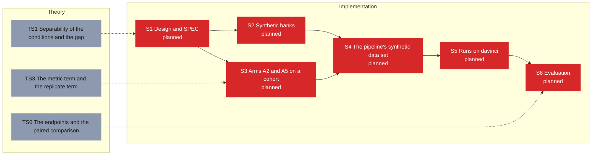

# Roadmap -- Synthetic A2/A5: arms A2 and A5 through the pipeline on a synthetic cohort (D-118..D-120)

Generated by `specs/roadmap/roadmap.py render` from `specs/roadmap/synth.yaml`; do not edit. Branch `sci/pipeline` at `68cc8a7` (2026-11-02); synced 2026-11-03T10:30:06+00:00 from chat.

## Legend

| State | Colour | Meaning |
|---|---|---|
| planned (implementation) | #d62828 | not implemented |
| local (implementation) | #f77f00 | implemented, not pushed |
| pushed (implementation) | #e9c46a | pushed, not tested |
| testing (implementation) | #3a86ff | independent tester running |
| tested (implementation) | #2a9d8f | tester passed, HPC run missing |
| running (implementation) | #8338ec | HPC job running |
| failing (implementation) | #b5174e | tester or HPC failure on the current code |
| done (implementation) | #2d9a3d | pushed, tested, HPC run done |
| open (theory) | #8d99ae | not started |
| studying (theory) | #3a86ff | being studied |
| closed (theory) | #2d9a3d | closed |

A dashed border marks a stage whose dependency is not in place (a block that is planned, local or failing; a topic not closed). Theory and implementation progress independently: the dotted edges between them are links, not conditions. REVISE marks a stage that has to change because of a decision taken on the other side.

## Theory

| Stage | Group | Status | Closed | Decision | Depends on | Linked blocks | Revise | Summary |
|---|---|---|---|---|---|---|---|---|
| TS1 Separability of the conditions and the gap |  | open |  |  |  | S1 |  | How separable the conditions are from theta against from the windows (the Bayes ceiling, the reference classifier); the gap modes as misspecification. |
| TS3 The metric term and the replicate term |  | open |  |  |  | S3 |  | What the metric term and the replicate term pull the encoder toward (E3, E5); the replicate target when the wells share nuisance (F-bm). |
| TS6 The endpoints and the paired comparison |  | open |  |  |  | S6 |  | The pseudo-real endpoint, coverage and the comparison paired by donor (E7). |

## Implementation

| Stage | Group | Blocks | Status | Why | Last change | Tester | HPC | Depends on | Theory (open) | Revise | Summary |
|---|---|---|---|---|---|---|---|---|---|---|---|
| S1 Design and SPEC |  |  | planned | step of the plan: no blocks defined yet (roadmap.py add block ... --parent S1) |  |  |  |  | TS1 (open) |  | The synthetic experiment in full notation in specs/SPEC.md -- arm S on the unit box, arm R's three conditions on donors of two wells, the gap at pi 0 and 0.3, the 180-s windows, the sizes and the seeds -- with the separability check that fixed "medium". |
| S2 Synthetic banks |  |  | planned | step of the plan: no blocks defined yet (roadmap.py add block ... --parent S2) |  |  |  | S1 |  |  | The bank builder gains a box prior for arm S that the runner reads as the unit box, balanced conditions on regular centres with a scale, distinct seeds for the two arms (F-aw), bank-wide ids (F-at), and the range shift at pi > 0 with fragment_duty clipped at 1 (F-av). |
| S3 Arms A2 and A5 on a cohort |  |  | planned | step of the plan: no blocks defined yet (roadmap.py add block ... --parent S3) |  |  |  | S1 | TS3 (open) |  | A2's class count taken from the metric source (F-t), replicate pairs across the two wells of one donor (F-ab), and a refusal when A5 has no pair (F-aa). |
| S4 The pipeline's synthetic data set |  |  | planned | step of the plan: no blocks defined yet (roadmap.py add block ... --parent S4) |  |  |  | S2, S3 |  |  | A synthetic data-set kind -- S1-S4 not applicable, S5 and S6 build the banks with the bench builder as job arrays -- and the project synth (tag synth, 120 cores). |
| S5 Runs on davinci |  |  | planned | step of the plan: no blocks defined yet (roadmap.py add block ... --parent S5) |  |  |  | S4 |  |  | One arm-S bank, two arm-R banks (pi 0 and 0.3), the four searches (S-A2 and S-A5 on each) of about 60 trials, and their best fits. |
| S6 Evaluation |  |  | planned | step of the plan: no blocks defined yet (roadmap.py add block ... --parent S6) |  |  |  | S5 | TS6 (open) |  | Per arm and gap level, the NLL of the withheld theta, the coverage and the condition recovered; A2 - A1 and A5 - A1 paired by donor. |

