# Roadmap -- Synthetic A2/A5: arms A2 and A5 through the pipeline on a synthetic cohort (D-118..D-120)

Generated by `specs/roadmap/roadmap.py render` from `specs/roadmap/synth.yaml`; do not edit. Branch `sci/pipeline` at `0631713` (2026-11-16); synced 2026-11-16T11:16:52+00:00 from chat.

```mermaid
flowchart LR
    classDef planned fill:#d62828,color:#ffffff,stroke:#d62828
    classDef local fill:#f77f00,color:#1a1a1a,stroke:#f77f00
    classDef pushed fill:#e9c46a,color:#1a1a1a,stroke:#e9c46a
    classDef testing fill:#3a86ff,color:#ffffff,stroke:#3a86ff
    classDef tested fill:#2a9d8f,color:#ffffff,stroke:#2a9d8f
    classDef running fill:#8338ec,color:#ffffff,stroke:#8338ec
    classDef failing fill:#b5174e,color:#ffffff,stroke:#b5174e
    classDef done fill:#2d9a3d,color:#ffffff,stroke:#2d9a3d
    classDef open fill:#8d99ae,color:#1a1a1a,stroke:#8d99ae
    classDef studying fill:#3a86ff,color:#ffffff,stroke:#3a86ff
    classDef closed fill:#2d9a3d,color:#ffffff,stroke:#2d9a3d
    classDef blocked stroke-dasharray:5 3,stroke:#333
    subgraph theory["Theory"]
        direction TB
        TS1["TS1 Separability of the conditions and the gap"]:::open
        subgraph grp_TS2["TS2 The synthetic benchmark's generator (1 open)"]
            direction TB
            T2.1["T2.1 How the synthetic traces are generated"]:::open
        end
        TS3["TS3 The metric term and the replicate term"]:::open
        subgraph grp_TS6["TS6 The endpoints and the paired comparison (2 open)"]
            direction TB
            T6.1["T6.1 Reading the synthetic run's results"]:::open
            T6.2["T6.2 Comparing two tuned arms: each arm's best trial refitted under one protocol<br/>REVISE: from I27"]:::open
        end
    end
    subgraph impl["Implementation"]
        direction TB
        S1["S1 Design and SPEC<br/>planned"]:::planned
        subgraph grp_S2["S2 Synthetic banks (3 done, 1 pushed)"]
            direction TB
            I11["I11 the box prior for arm S<br/>Block 11 done"]:::done
            I12["I12 arm R's cohort and bank-wide ids<br/>Block 12 done"]:::done
            I13["I13 the shifted duty clipped at 1<br/>Block 13 done"]:::done
            I25["I25 the bench's label axes from the configuration<br/>Block 25 pushed"]:::pushed
        end
        subgraph grp_S3["S3 Arms A2 and A5 on a cohort (1 done)"]
            direction TB
            I14["I14 arms A2 and A5 on a cohort<br/>Block 14 done"]:::done
        end
        subgraph grp_S4["S4 The pipeline's synthetic data set (3 done, 1 pushed)"]
            direction TB
            I15["I15 the synthetic kind: configuration, graph and run views<br/>Block 15 done"]:::done
            I16["I16 the synthetic banks<br/>Block 16 done"]:::done
            I17["I17 the project synth<br/>Block 17 pushed"]:::pushed
            I26["I26 one search per arm: the term-only campaigns<br/>Block 26 done"]:::done
        end
        subgraph grp_S5["S5 Runs on davinci (1 done)"]
            direction TB
            I24["I24 the purge of a synthetic project, with the archive<br/>Block 24 done"]:::done
        end
        subgraph grp_S6["S6 Evaluation (4 pushed, 4 done)"]
            direction TB
            I18["I18 the other arm's best fit<br/>Block 18 pushed"]:::pushed
            I19["I19 the evaluation's sampler<br/>Block 19 pushed"]:::pushed
            I20["I20 the evaluation's quantities<br/>Block 20 done"]:::done
            I21["I21 the evaluation's figures<br/>Block 21 done"]:::done
            I22["I22 the evaluation's jobs and run sheet<br/>Block 22 pushed"]:::pushed
            I23["I23 the data overview<br/>Block 23 pushed"]:::pushed
            I27["I27 the comparisons across searches<br/>Block 27 done"]:::done
            I28["I28 the comparisons' figures<br/>Block 28 done"]:::done
        end
        S1 --> grp_S2
        S1 --> grp_S3
        grp_S2 --> grp_S4
        grp_S3 --> grp_S4
        grp_S4 --> grp_S5
        grp_S5 --> grp_S6
        I11 --> I14
        I12 --> I14
        I11 --> I16
        I12 --> I16
        I13 --> I16
        I15 --> I16
        I14 --> I17
        I15 --> I17
        I16 --> I17
        I18 --> I19
        I19 --> I20
        I20 --> I21
        I19 --> I22
        I20 --> I22
        I21 --> I22
        I19 --> I23
        I22 --> I23
        I13 --> I25
        I16 --> I25
        I19 --> I25
        I14 --> I26
        I15 --> I26
        I17 --> I26
        I19 --> I27
        I20 --> I27
        I22 --> I27
        I21 --> I28
        I27 --> I28
    end
    TS1 -.-> S1
    grp_TS2 -.-> grp_S2
    TS3 -.-> grp_S3
    grp_TS6 -.-> grp_S6
    T6.2 -.-> I18
    T2.1 -.-> I23
    style grp_TS2 stroke:#8d99ae,stroke-width:3px
    style grp_TS6 stroke:#8d99ae,stroke-width:3px
    style grp_S2 stroke:#e9c46a,stroke-width:3px
    style grp_S3 stroke:#2d9a3d,stroke-width:3px
    style grp_S4 stroke:#e9c46a,stroke-width:3px
    style grp_S5 stroke:#2d9a3d,stroke-width:3px
    style grp_S6 stroke:#e9c46a,stroke-width:3px
```

## Legend

| State | Colour | Meaning |
|---|---|---|
| planned (implementation) | #d62828 | not implemented |
| local (implementation) | #f77f00 | implemented, not pushed |
| pushed (implementation) | #e9c46a | pushed, not tested |
| testing (implementation) | #3a86ff | independent tester running |
| tested (implementation) | #2a9d8f | tester passed, HPC run missing |
| running (implementation) | #8338ec | HPC job running |
| failing (implementation) | #b5174e | tester or HPC failure on the current code |
| done (implementation) | #2d9a3d | pushed, tested, HPC run done |
| open (theory) | #8d99ae | not started |
| studying (theory) | #3a86ff | being studied |
| closed (theory) | #2d9a3d | closed |

A dashed border marks a stage whose dependency is not in place (a block that is planned, local or failing; a topic not closed). Theory and implementation progress independently: the dotted edges between them are links, not conditions. REVISE marks a stage that has to change because of a decision taken on the other side.

## Theory

| Stage | Group | Status | Closed | Decision | Depends on | Linked blocks | Revise | Summary |
|---|---|---|---|---|---|---|---|---|
| TS1 Separability of the conditions and the gap |  | open |  |  |  | S1 |  | How separable the conditions are from theta against from the windows (the Bayes ceiling, the reference classifier); the gap modes as misspecification. |
| TS2 The synthetic benchmark's generator |  | open |  |  |  | S2, I11, I12, I13, I25 |  | The concepts the synthetic banks rest on: how the bench generator turns theta into a window (the user, 2026-11-03). |
| TS3 The metric term and the replicate term |  | open |  |  |  | S3, I14 |  | What the metric term and the replicate term pull the encoder toward (E3, E5); the replicate target when the wells share nuisance (F-bm). |
| TS6 The endpoints and the paired comparison |  | open |  |  |  | S6, I18, I19, I20, I21, I22, I23, I27, I28 |  | The pseudo-real endpoint, coverage and the comparison paired by donor (E7). |
| T2.1 How the synthetic traces are generated | TS2 | open |  |  |  | I23 |  | From theta to a window: the affine map to 10 physical burst parameters (7 condition-bearing, 3 free); the spike generator for 100 units (gamma-renewal burst onsets, lognormal envelopes, fragmentation, beta participation, Poisson spikes); the IFR binned at 100 Hz, Gaussian-smoothed and divided by the units, cut into 180-s windows; the nuisance x_obs = A(nu) x + b(nu, t), nested batch : donor : well; the two priors (the box for arm S, the conditions' truncated normals for arm R); the gap's three modes. |
| T6.1 Reading the synthetic run's results | TS6 | open |  |  |  |  |  | What the pseudo-real NLL -log q(theta* / h(x)) measures -- the expected KL to the cohort's posterior plus an entropy that cancels between models; the box prior's score 0; L on the simulator against L_pr on the cohort -- why the range shift makes the sharper posteriors score worse at R3 (the pseudo-true theta-dagger, the trade-off between width and offset), the five-member mixture against its members (Jensen), and why A2 or A5 against A1 is decided by the donor-paired two-clause rule with a donor-cluster bootstrap, not by single-seed trials. |
| T6.2 Comparing two tuned arms: each arm's best trial refitted under one protocol | TS6 | open |  |  |  | I18 | from I27 D-136: the comparison is now across searches: each arm has its own search of equal budget (D-132), each term arm is compared with S-A1's ensemble and A2 with A5 (D-136); the summary's 'two ensembles of a search with a term' and 'the trials each arm received as search effort' need revising | How the two ensembles of a search with a term are chosen and trained so that their donor-paired comparison is fair (block 18): each arm represented by its own best trial on L, the same rule for both (D-121), and both refitted as M = 5 seed ensembles under one member protocol on a fresh donor split (split seed 1, train seeds 1-5, the same budget). What the comparison then measures -- each arm at its own best tuning -- and what it does not: the term switched on and off at fixed hyperparameters (an ablation); why seed m of one arm has no counterpart in the other, so the pairing is by donor, not by seed; the bias of a minimum read on the rows that chose it (selection bias) and why the fresh split and the cohort endpoint avoid it; the trials each arm received as search effort. The mixture, the pseudo-real NLL and the two-clause rule are T6.1's. |

## Implementation

| Stage | Group | Blocks | Status | Why | Last change | Tester | HPC | Depends on | Theory (open) | Revise | Summary |
|---|---|---|---|---|---|---|---|---|---|---|---|
| S1 Design and SPEC |  |  | planned | step of the plan: no blocks defined yet (roadmap.py add block ... --parent S1) |  |  |  |  | TS1 (open) |  | The synthetic experiment in full notation in specs/SPEC.md -- arm S on the unit box, arm R's three conditions on donors of two wells, the gap at pi 0 and 0.3, the 180-s windows, the sizes and the seeds -- with the separability check that fixed "medium". |
| S2 Synthetic banks |  |  | pushed | group: least advanced member is pushed |  |  |  | S1 | TS2 (open) |  | The bank builder gains a box prior for arm S that the runner reads as the unit box, balanced conditions on regular centres with a scale, distinct seeds for the two arms (F-aw), bank-wide ids (F-at), and the range shift at pi > 0 with fragment_duty clipped at 1 (F-av). |
| S3 Arms A2 and A5 on a cohort |  |  | done | group: least advanced member is done |  |  |  | S1 | TS3 (open) |  | A2's class count taken from the metric source (F-t), replicate pairs across the two wells of one donor (F-ab), and a refusal when A5 has no pair (F-aa). |
| S4 The pipeline's synthetic data set |  |  | pushed | group: least advanced member is pushed |  |  |  | S2, S3 |  |  | A synthetic data-set kind of the pipeline -- no S1-S6 of a recorded data set; the banks built by the bench builder, one job per shard and a record job; a search and a best fit per entry -- and the project synth (tag synth, 120 cores). |
| S5 Runs on davinci |  |  | done | group: least advanced member is done |  |  |  | S4 |  |  | One arm-S bank, two arm-R banks (pi 0 and 0.3), five searches of about 60 trials and their best fits. Relaunched by D-132 (2026-11-13): the first run archived and deleted (I24), then fragment_duty class-bearing and one search per arm -- S-A1 and the term-only A2 and A5 on each cohort -- each refitted as a 5-seed ensemble. |
| S6 Evaluation |  |  | pushed | group: least advanced member is pushed |  |  |  | S5 | TS6 (open) |  | Per arm and gap level, the NLL of the withheld theta, the coverage and the condition recovered; A2 - A1 and A5 - A1 paired by donor. |
| I11 the box prior for arm S | S2 | 11 | done | tester PASS WITH ISSUES on bd7651f | 478d75f 2026-11-14 | PASS WITH ISSUES bd7651f |  |  | TS2 (open) |  | build_latent_bank.py --prior box: theta uniform on the unit box, cls -1, latent_spec kind box; the runner reads it as the unit box (L0 = 0). |
| I12 arm R's cohort and bank-wide ids | S2 | 12 | done | tester PASS WITH ISSUES on 57e294d | 478d75f 2026-11-14 | PASS WITH ISSUES 57e294d |  |  | TS2 (open) |  | Regular class centres from the DSN's simplex with a scale, a set number of donors per class on a seeded permutation, and donor/well/batch ids unique across shards (F-at). |
| I13 the shifted duty clipped at 1 | S2 | 13 | done | tester PASS WITH ISSUES on 8d5b162 | 44f812b 2026-11-13 | PASS WITH ISSUES 8d5b162 |  |  | TS2 (open) |  | fragment_duty clipped at 1 under the range shift, so a pi = 0.3 bench cohort builds (F-av). |
| I14 arms A2 and A5 on a cohort | S3 | 14 | done | tester PASS WITH ISSUES on 8d5b162 | 59465e1 2026-11-03 | PASS WITH ISSUES 8d5b162 |  | I11, I12 | TS3 (open) |  | Replicate pairs across two wells of one donor (F-ab), A5 refuses without pairs (F-aa), the DSN loss's classes counted on its source (F-t), a refusal when arms S and R share a seed (F-aw). |
| I15 the synthetic kind: configuration, graph and run views | S4 | 15 | done | tester PASS WITH ISSUES on e6e7af0 | e6e7af0 2026-11-14 | PASS WITH ISSUES e6e7af0 |  |  |  |  | "kind": "synthetic" -- its schema and cross-checks (distinct seeds, shard sizes, the real banks the searches name); the graph of 13 stages; each search and best fit is S7 and S8 on its own view (folders, campaign, the simulated bank and its real bank, S-A1 included). |
| I16 the synthetic banks | S4 | 16 | done | tester PASS WITH ISSUES on 57e294d | 478d75f 2026-11-14 | PASS WITH ISSUES 57e294d |  | I11, I12, I13, I15 |  |  | One job per shard of build_latent_bank.py, then a record job (tools/synth_bank_record.py: CRCs, digests, rows, wells per donor, classes); a shard already built is kept, a folder of another build refused. |
| I17 the project synth | S4 | 17 | pushed | no tester report covers commit 20d1f5b (last report 2026-11-16 at bd7651f) | 20d1f5b 2026-11-16 | PASS WITH ISSUES bd7651f (outdated) |  | I14, I15, I16 |  |  | projects/synth/synth.json (D-118..D-123: arm S in 20 shards, R0 and R3, five searches of 60 trials on 8-core trials, best fits of 5 members, 120 cores) and its run sheet Y1-Y4; end to end on a reduced copy under the fake PBS. |
| I18 the other arm's best fit | S6 | 18 | pushed | no tester report covers commit 20d1f5b (last report 2026-11-16 at bd7651f) | 20d1f5b 2026-11-16 | PASS WITH ISSUES bd7651f (outdated) |  |  | TS6 (open), T6.2 (open) |  | best_fit_alt_<q>: for each search with a term, the best trial on L of the arm its finalist is not, fitted as a second ensemble of 5 members with the best fit's settings (the tuner's finalists --arm; alt_best_fit, synth.json v3; D-126). |
| I19 the evaluation's sampler | S6 | 19 | pushed | no tester report covers commit 62297c5 (last report 2026-11-16 at bd7651f) | 62297c5 2026-11-16 | PASS WITH ISSUES bd7651f (outdated) |  | I18 | TS6 (open) |  | One davinci job per ensemble: the members rebuilt from their records and checkpoints; per data set (arm S's report split, R0, R3, R3 against theta-dagger) the NLL at the reference, posterior draws, the mixture's log density at the draws and the embeddings, saved as .npz (drafted). |
| I20 the evaluation's quantities | S6 | 20 | done | tester PASS WITH ISSUES on bd7651f | bc569d4 2026-11-16 | PASS WITH ISSUES bd7651f |  | I19 | TS6 (open) |  | From the .npz: NLL per window and donor, HPD expected coverage, SBC ranks, TARP, recovery, z-scores and contraction, the donor-paired differences with their bootstrap, the embeddings' MMD, the posterior-predictive check, L-C2ST (drafted). |
| I21 the evaluation's figures | S6 | 21 | done | tester PASS WITH ISSUES on bd7651f | 0054204 2026-11-16 | PASS WITH ISSUES bd7651f |  | I20 | TS6 (open) |  | The literature's figures per arm and per comparison, four families: calibration, accuracy and sharpness, posterior views and checks, embeddings and the search (drafted). |
| I22 the evaluation's jobs and run sheet | S6 | 22 | pushed | no tester report covers commit 62297c5 (last report 2026-11-16 at bd7651f) | 62297c5 2026-11-16 | PASS WITH ISSUES bd7651f (outdated) |  | I19, I20, I21 | TS6 (open) |  | The sampling and report job scripts with the roadmap's markers, the README's run sheet, and the evaluation end to end on the reduced project (drafted). |
| I23 the data overview | S6 | 23 | pushed | no tester report covers commit 62297c5 (last report 2026-11-14 at 8d5b162) | 62297c5 2026-11-16 | PASS WITH ISSUES 8d5b162 (outdated) |  | I19, I22 | T2.1 (open), TS6 (open) |  | What the synthetic data set looks like before any network: example windows of R0 and R3 by condition and of the simulated bank, full and zoomed; the eight window statistics of 4,000 simulated windows (the prior predictive) against the cohorts'; the cohorts' theta* on the unit box and theta-dagger on R3's shifted axes; the statistics on the simulated windows' first two principal components. One small job (--what data), nine figures (D-130). |
| I24 the purge of a synthetic project, with the archive | S5 | 24 | done | tester PASS WITH ISSUES on 8d5b162 | fcaf1cd 2026-11-13 | PASS WITH ISSUES 8d5b162 |  |  |  |  | Before the relaunch (D-132): the last run's evaluation packed into one archive (all but the samples and the calibration bank), then its evaluation, best fits, searches, banks and the work root's state deleted by the user through the list-then-delete tool with a CODE. |
| I25 the bench's label axes from the configuration | S2 | 25 | pushed | no tester report covers commit 0054204 (last report 2026-11-14 at 57e294d) | 0054204 2026-11-16 | PASS WITH ISSUES 57e294d (outdated) |  | I13, I16, I19 | TS2 (open) |  | fragment_duty class-bearing (D-132): the builder takes the label axes from synthetic.builder.label_axes (synth.json v4: axes 0-7, centre scale 0.562743, the centres still 0.442 apart), gap mode (a) shifts the bank's own free axes (8-9), and the evaluation reads the split from the bank's sidecar. |
| I26 one search per arm: the term-only campaigns | S4 | 26 | done | tester PASS WITH ISSUES on 8d5b162 | 44f812b 2026-11-13 | PASS WITH ISSUES 8d5b162 |  | I14, I15, I17 |  |  | Campaigns S-A2-only and S-A5-only (the term always on, no nested A1 trials) and synth.json v4's five searches -- S-A1 on R0, each term arm on R0 and on R3 -- each with its own best fit of 5 members and no fit of another arm (D-132). |
| I27 the comparisons across searches | S6 | 27 | done | tester PASS WITH ISSUES on bd7651f | bc569d4 2026-11-16 | PASS WITH ISSUES bd7651f |  | I19, I20, I22 | TS6 (open) |  | Each term search's ensemble against its A1 reference -- its own A1 ensemble in a campaign nesting A1, S-A1's in a term-only one -- and A2 against A5 on each cohort, donor-paired as E3 on the data sets both are sampled on; every comparison not made is named; the launcher lists them (D-132 (5), D-136). |
| I28 the comparisons' figures | S6 | 28 | done | tester PASS WITH ISSUES on bd7651f | 0054204 2026-11-16 | PASS WITH ISSUES bd7651f |  | I21, I27 | TS6 (open) |  | Per comparison under comparisons/<name>/: both ensembles' coverage, donor NLL, PPC and L-C2ST overlaid and the E3 forest plot per shared data set; the searches' own figures; across/dbar in one panel per kind (D-136). |

