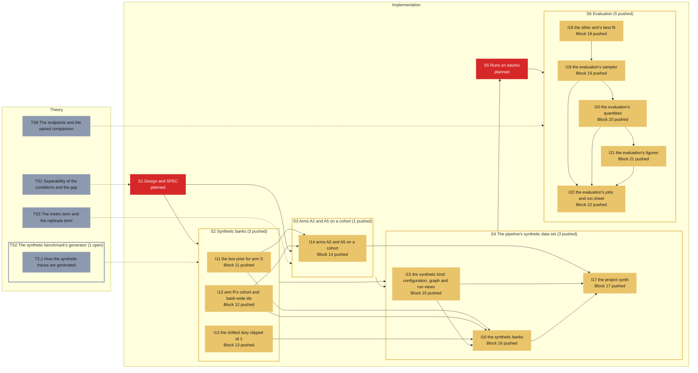

# Roadmap -- Synthetic A2/A5: arms A2 and A5 through the pipeline on a synthetic cohort (D-118..D-120)

Generated by `specs/roadmap/roadmap.py render` from `specs/roadmap/synth.yaml`; do not edit. Branch `sci/pipeline` at `61f4262` (2026-11-11); synced 2026-11-11T15:19:03+00:00 from chat 2026-11-11 (blocks 20-22 pushed).

## Legend

| State | Colour | Meaning |
|---|---|---|
| planned (implementation) | #d62828 | not implemented |
| local (implementation) | #f77f00 | implemented, not pushed |
| pushed (implementation) | #e9c46a | pushed, not tested |
| testing (implementation) | #3a86ff | independent tester running |
| tested (implementation) | #2a9d8f | tester passed, HPC run missing |
| running (implementation) | #8338ec | HPC job running |
| failing (implementation) | #b5174e | tester or HPC failure on the current code |
| done (implementation) | #2d9a3d | pushed, tested, HPC run done |
| open (theory) | #8d99ae | not started |
| studying (theory) | #3a86ff | being studied |
| closed (theory) | #2d9a3d | closed |

A dashed border marks a stage whose dependency is not in place (a block that is planned, local or failing; a topic not closed). Theory and implementation progress independently: the dotted edges between them are links, not conditions. REVISE marks a stage that has to change because of a decision taken on the other side.

## Theory

| Stage | Group | Status | Closed | Decision | Depends on | Linked blocks | Revise | Summary |
|---|---|---|---|---|---|---|---|---|
| TS1 Separability of the conditions and the gap |  | open |  |  |  | S1 |  | How separable the conditions are from theta against from the windows (the Bayes ceiling, the reference classifier); the gap modes as misspecification. |
| TS2 The synthetic benchmark's generator |  | open |  |  |  | S2, I11, I12, I13 |  | The concepts the synthetic banks rest on: how the bench generator turns theta into a window (the user, 2026-11-03). |
| TS3 The metric term and the replicate term |  | open |  |  |  | S3, I14 |  | What the metric term and the replicate term pull the encoder toward (E3, E5); the replicate target when the wells share nuisance (F-bm). |
| TS6 The endpoints and the paired comparison |  | open |  |  |  | S6, I18, I19, I20, I21, I22 |  | The pseudo-real endpoint, coverage and the comparison paired by donor (E7). |
| T2.1 How the synthetic traces are generated | TS2 | open |  |  |  |  |  | From theta to a window: the affine map to 10 physical burst parameters (7 condition-bearing, 3 free); the spike generator for 100 units (gamma-renewal burst onsets, lognormal envelopes, fragmentation, beta participation, Poisson spikes); the IFR binned at 100 Hz, Gaussian-smoothed and divided by the units, cut into 180-s windows; the nuisance x_obs = A(nu) x + b(nu, t), nested batch : donor : well; the two priors (the box for arm S, the conditions' truncated normals for arm R); the gap's three modes. |

## Implementation

| Stage | Group | Blocks | Status | Why | Last change | Tester | HPC | Depends on | Theory (open) | Revise | Summary |
|---|---|---|---|---|---|---|---|---|---|---|---|
| S1 Design and SPEC |  |  | planned | step of the plan: no blocks defined yet (roadmap.py add block ... --parent S1) |  |  |  |  | TS1 (open) |  | The synthetic experiment in full notation in specs/SPEC.md -- arm S on the unit box, arm R's three conditions on donors of two wells, the gap at pi 0 and 0.3, the 180-s windows, the sizes and the seeds -- with the separability check that fixed "medium". |
| S2 Synthetic banks |  |  | pushed | group: least advanced member is pushed |  |  |  | S1 | TS2 (open) |  | The bank builder gains a box prior for arm S that the runner reads as the unit box, balanced conditions on regular centres with a scale, distinct seeds for the two arms (F-aw), bank-wide ids (F-at), and the range shift at pi > 0 with fragment_duty clipped at 1 (F-av). |
| S3 Arms A2 and A5 on a cohort |  |  | pushed | group: least advanced member is pushed |  |  |  | S1 | TS3 (open) |  | A2's class count taken from the metric source (F-t), replicate pairs across the two wells of one donor (F-ab), and a refusal when A5 has no pair (F-aa). |
| S4 The pipeline's synthetic data set |  |  | pushed | group: least advanced member is pushed |  |  |  | S2, S3 |  |  | A synthetic data-set kind of the pipeline -- no S1-S6 of a recorded data set; the banks built by the bench builder, one job per shard and a record job; a search and a best fit per entry -- and the project synth (tag synth, 120 cores). |
| S5 Runs on davinci |  |  | planned | step of the plan: no blocks defined yet (roadmap.py add block ... --parent S5) |  |  |  | S4 |  |  | One arm-S bank, two arm-R banks (pi 0 and 0.3), the five searches (S-A2 and S-A5 on each, one S-A1, D-122) of about 60 trials, and their best fits. |
| S6 Evaluation |  |  | pushed | group: least advanced member is pushed |  |  |  | S5 | TS6 (open) |  | Per arm and gap level, the NLL of the withheld theta, the coverage and the condition recovered; A2 - A1 and A5 - A1 paired by donor. |
| I11 the box prior for arm S | S2 | 11 | pushed | no tester report covers commit 59465e1 (last report 2026-10-20 at 04cb7ab) | 59465e1 2026-11-03 | PASS WITH ISSUES 04cb7ab (outdated) |  |  | TS2 (open) |  | build_latent_bank.py --prior box: theta uniform on the unit box, cls -1, latent_spec kind box; the runner reads it as the unit box (L0 = 0). |
| I12 arm R's cohort and bank-wide ids | S2 | 12 | pushed | no tester report covers commit 59465e1 (last report 2026-10-20 at 04cb7ab) | 59465e1 2026-11-03 | PASS WITH ISSUES 04cb7ab (outdated) |  |  | TS2 (open) |  | Regular class centres from the DSN's simplex with a scale, a set number of donors per class on a seeded permutation, and donor/well/batch ids unique across shards (F-at). |
| I13 the shifted duty clipped at 1 | S2 | 13 | pushed | no tester report covers commit 59465e1 (last report 2026-10-20 at 04cb7ab) | 59465e1 2026-11-03 | PASS WITH ISSUES 04cb7ab (outdated) |  |  | TS2 (open) |  | fragment_duty clipped at 1 under the range shift, so a pi = 0.3 bench cohort builds (F-av). |
| I14 arms A2 and A5 on a cohort | S3 | 14 | pushed | no tester report covers commit 59465e1 (last report 2026-10-20 at 04cb7ab) | 59465e1 2026-11-03 | PASS WITH ISSUES 04cb7ab (outdated) |  | I11, I12 | TS3 (open) |  | Replicate pairs across two wells of one donor (F-ab), A5 refuses without pairs (F-aa), the DSN loss's classes counted on its source (F-t), a refusal when arms S and R share a seed (F-aw). |
| I15 the synthetic kind: configuration, graph and run views | S4 | 15 | pushed | no tester report covers commit e92d451 (last report 2026-10-20 at 04cb7ab) | e92d451 2026-11-11 | PASS WITH ISSUES 04cb7ab (outdated) |  |  |  |  | "kind": "synthetic" -- its schema and cross-checks (distinct seeds, shard sizes, the real banks the searches name); the graph of 13 stages; each search and best fit is S7 and S8 on its own view (folders, campaign, the simulated bank and its real bank, S-A1 included). |
| I16 the synthetic banks | S4 | 16 | pushed | no tester report covers commit e92d451 (last report 2026-10-20 at 04cb7ab) | e92d451 2026-11-11 | PASS WITH ISSUES 04cb7ab (outdated) |  | I11, I12, I13, I15 |  |  | One job per shard of build_latent_bank.py, then a record job (tools/synth_bank_record.py: CRCs, digests, rows, wells per donor, classes); a shard already built is kept, a folder of another build refused. |
| I17 the project synth | S4 | 17 | pushed | no tester report covers commit 61f4262 (last report 2026-10-20 at 04cb7ab) | 61f4262 2026-11-11 | PASS WITH ISSUES 04cb7ab (outdated) |  | I14, I15, I16 |  |  | projects/synth/synth.json (D-118..D-123: arm S in 20 shards, R0 and R3, five searches of 60 trials on 8-core trials, best fits of 5 members, 120 cores) and its run sheet Y1-Y4; end to end on a reduced copy under the fake PBS. |
| I18 the other arm's best fit | S6 | 18 | pushed | no tester report covers commit 61f4262 (last report 2026-10-20 at 04cb7ab) | 61f4262 2026-11-11 | PASS WITH ISSUES 04cb7ab (outdated) |  |  | TS6 (open) |  | best_fit_alt_<q>: for each search with a term, the best trial on L of the arm its finalist is not, fitted as a second ensemble of 5 members with the best fit's settings (the tuner's finalists --arm; alt_best_fit, synth.json v3; D-126). |
| I19 the evaluation's sampler | S6 | 19 | pushed | no tester report covers commit 61f4262 (last report 2026-10-20 at 04cb7ab) | 61f4262 2026-11-11 | PASS WITH ISSUES 04cb7ab (outdated) |  | I18 | TS6 (open) |  | One davinci job per ensemble: the members rebuilt from their records and checkpoints; per data set (arm S's report split, R0, R3, R3 against theta-dagger) the NLL at the reference, posterior draws, the mixture's log density at the draws and the embeddings, saved as .npz (drafted). |
| I20 the evaluation's quantities | S6 | 20 | pushed | no tester report covers commit 61f4262 (last report 2026-10-20 at 04cb7ab) | 61f4262 2026-11-11 | PASS WITH ISSUES 04cb7ab (outdated) |  | I19 | TS6 (open) |  | From the .npz: NLL per window and donor, HPD expected coverage, SBC ranks, TARP, recovery, z-scores and contraction, the donor-paired differences with their bootstrap, the embeddings' MMD, the posterior-predictive check, L-C2ST (drafted). |
| I21 the evaluation's figures | S6 | 21 | pushed | no tester report covers commit 61f4262 (last report 2026-10-20 at 04cb7ab) | 61f4262 2026-11-11 | PASS WITH ISSUES 04cb7ab (outdated) |  | I20 | TS6 (open) |  | The literature's figures per arm and per comparison, four families: calibration, accuracy and sharpness, posterior views and checks, embeddings and the search (drafted). |
| I22 the evaluation's jobs and run sheet | S6 | 22 | pushed | no tester report covers commit 61f4262 (last report 2026-10-20 at 04cb7ab) | 61f4262 2026-11-11 | PASS WITH ISSUES 04cb7ab (outdated) |  | I19, I20, I21 | TS6 (open) |  | The sampling and report job scripts with the roadmap's markers, the README's run sheet, and the evaluation end to end on the reduced project (drafted). |

