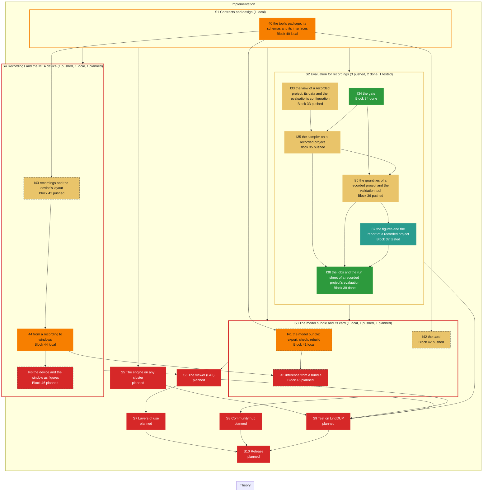

# Roadmap -- The tool: the engine, the model bundle and its card, the viewer (D-157)

Generated by `specs/roadmap/roadmap.py render` from `specs/roadmap/tool.yaml`; do not edit. Branch `sci/tool` at `d19fb87` (2026-11-27); synced 2026-11-27T22:59:06+00:00 from chat.

## Legend

| State | Colour | Meaning |
|---|---|---|
| planned (implementation) | #d62828 | not implemented |
| local (implementation) | #f77f00 | implemented, not pushed |
| pushed (implementation) | #e9c46a | pushed, not tested |
| testing (implementation) | #3a86ff | independent tester running |
| tested (implementation) | #2a9d8f | tester passed, HPC run missing |
| running (implementation) | #8338ec | HPC job running |
| failing (implementation) | #b5174e | tester or HPC failure on the current code |
| done (implementation) | #2d9a3d | pushed, tested, HPC run done |
| open (theory) | #8d99ae | not started |
| studying (theory) | #3a86ff | being studied |
| closed (theory) | #2d9a3d | closed |

A dashed border marks a stage whose dependency is not in place (a block that is planned, local or failing; a topic not closed). Theory and implementation progress independently: the dotted edges between them are links, not conditions. REVISE marks a stage that has to change because of a decision taken on the other side.

## Theory

| Stage | Group | Status | Closed | Decision | Depends on | Linked blocks | Revise | Summary |
|---|---|---|---|---|---|---|---|---|

## Implementation

| Stage | Group | Blocks | Status | Why | Last change | Tester | HPC | Depends on | Theory (open) | Revise | Summary |
|---|---|---|---|---|---|---|---|---|---|---|---|
| S1 Contracts and design |  |  | local | group: least advanced member is local |  |  |  |  |  |  | The tool's specification: the model bundle, and four plug-in contracts (the bank format a simulator writes, the recording adapter, the simulator at a given theta, the scheduler). |
| S2 Evaluation for recordings |  |  | pushed | group: least advanced member is pushed |  |  |  | S1 |  |  | For any recorded project: the posteriors on the real windows; the calibration on its held-out simulations, with contraction and the edge rows apart; the per-window gate; the predictive check through the project's own simulator, per member; the report and its figures. Built in two waves: everything but the predictive check first. |
| S3 The model bundle and its card |  |  | planned | group: least advanced member is planned |  |  |  | S1, S2 |  |  | A trained ensemble as one self-contained, safely loadable package (weights, architecture, prior box with axis names and units, extraction parameters, held-out evaluation, reference embeddings) and its card: a predefined file the author fills, checked by a validator. |
| S4 Recordings and the MEA device |  |  | planned | group: least advanced member is planned |  |  |  | S1 |  |  | Recording adapters, the device layout, and the extraction configuration turned into subregions and windows, runnable on a laptop. |
| S5 The engine on any cluster |  |  | planned | step of the plan: no blocks defined yet (roadmap.py add block ... --parent S5) |  |  |  | S1 |  |  | The non-GUI command line; one scheduler interface with several back ends; a setup probe that finds the scheduler, the queues and the environment tools, runs a test job and writes a site profile the user can edit. |
| S6 The viewer (GUI) |  |  | planned | step of the plan: no blocks defined yet (roadmap.py add block ... --parent S6) |  |  |  | S3, S4 |  |  | Load a bundle and recordings, get posteriors with the three checks. Views: the device with its electrodes and the chosen subregions, traces and windows, posteriors, checks, wells and conditions compared. |
| S7 Layers of use |  |  | planned | step of the plan: no blocks defined yet (roadmap.py add block ... --parent S7) |  |  |  | S6 |  |  | Guided, standard and expert modes; plain and formal explanations inside the interface; presets, a glossary, tutorials, an example data set and an example bundle. |
| S8 Community hub |  |  | planned | step of the plan: no blocks defined yet (roadmap.py add block ... --parent S8) |  |  |  | S3 |  |  | Where bundles are shared: submission with the mandatory card, automatic validation, versions, licence and citation; browsing from the viewer. |
| S9 Test on LindDUP |  |  | planned | step of the plan: no blocks defined yet (roadmap.py add block ... --parent S9) |  |  |  | S2, S3, S5, S6 |  |  | The whole chain end to end on LindDUP's best fits (evaluation, bundle, viewer): LindDUP is the test of the tool, not its design target. |
| S10 Release |  |  | planned | step of the plan: no blocks defined yet (roadmap.py add block ... --parent S10) |  |  |  | S7, S8, S9 |  |  | Installable packages, a licence, continuous integration, the documentation and the final audit. |
| I33 the view of a recorded project, its data and the evaluation's configuration | S2 | 33 | pushed | no tester report covers commit 7bf7590 (last report 2026-11-27 at a7914f9) | 7bf7590 2026-11-27 | PASS WITH ISSUES a7914f9 (outdated) |  |  |  |  | Reads any recorded project as its ensembles, its simulated bank and its recording bank (and a synthetic project as if it were recorded, for the validation); the held-out rows, the draw rows, a recording bank's windows with their ids and no parameter; the evaluation's configuration; the tests' fixture (drafted). |
| I34 the gate | S2 | 34 | done | tester PASS WITH ISSUES on 7eadb8d | c560360 2026-11-23 | PASS WITH ISSUES 7eadb8d |  |  |  |  | Per window: each member's distance of its embedding to reference simulated embeddings, ranked against held-out simulated windows; the ranks averaged over the members into one statistic, with its p-value from a third set of held-out simulated networks (D-161) (drafted). |
| I35 the sampler on a recorded project | S2 | 35 | pushed | no tester report covers commit 7bf7590 (last report 2026-11-27 at a7914f9) | 7bf7590 2026-11-27 | PASS WITH ISSUES a7914f9 (outdated) |  | I33, I34 |  |  | One cluster job per ensemble: the members rebuilt and checked against their own per-row NLL; on the held-out simulations the NLL on every row and the draws on the draw rows; on the recordings the draws and their densities; the embeddings and the gate's roles; saved as .npz (drafted). |
| I36 the quantities of a recorded project and the validation tool | S2 | 36 | pushed | no tester report covers commit 7bf7590 (last report 2026-11-27 at a7914f9) | 7bf7590 2026-11-27 | PASS WITH ISSUES a7914f9 (outdated) |  | I34, I35 |  |  | NLL, expected coverage, SBC, TARP, recovery and contraction on the held-out simulations, with the edge rows apart; per recorded window the posterior's summaries and contraction; per well the mixture over its windows; the gate's p-values and flagged shares; the arms compared on the simulations; and the tool that checks the new path against the synthetic evaluation (drafted). |
| I37 the figures and the report of a recorded project | S2 | 37 | tested | tester PASS WITH ISSUES on dc096e5; HPC run missing | dc096e5 2026-11-23 | PASS WITH ISSUES dc096e5 |  | I36 |  |  | The figures per ensemble, recording bank and comparison, drawn from the metrics alone, and one report of tables that states numbers and draws no conclusion (drafted). |
| I38 the jobs and the run sheet of a recorded project's evaluation | S2 | 38 | done | tester PASS WITH ISSUES on a7914f9 | a7914f9 2026-11-27 | PASS WITH ISSUES a7914f9 |  | I35, I36, I37 |  |  | The launcher: one sampling job per ensemble, the report after them, and for the synthetic project read as recorded the validation after the report; the run sheets (drafted). |
| I40 the tool's package, its schemas and its interfaces | S1 | 40 | local | commit d19fb87 is not on origin/sci/tool | d19fb87 2026-11-27 |  |  |  |  |  | The sbitool package: the list of what a bundle and a card must contain with their validators, the description of a recording, and the interfaces a recording reader, a simulator and a scheduler must offer. |
| I41 the model bundle: export, check, rebuild | S3 | 41 | local | commit d19fb87 is not on origin/sci/tool | d19fb87 2026-11-27 |  |  | I40 |  |  | Turns a trained ensemble into one safe file (weights as safetensors, a manifest, the card, its held-out evaluation and the gate's reference data), checks such a file, and rebuilds the networks from it without the simulated bank. |
| I42 the card | S3 | 42 | pushed | no tester report covers commit baebb63 (last report 2026-10-20 at 04cb7ab) | baebb63 2026-11-27 | PASS WITH ISSUES 04cb7ab (outdated) |  | I40 |  |  | The Markdown card every bundle carries: a template pre-filled from the pipeline's records, and the validator that says whether it is complete. |
| I43 recordings and the device's layout | S4 | 43 | pushed | no tester report covers commit 4b03047 (last report 2026-10-20 at 04cb7ab) | 4b03047 2026-11-27 | PASS WITH ISSUES 04cb7ab (outdated) |  | I40 |  |  | Reads a recording into spike times per electrode with the electrodes' positions: the extractor's spike-train files and the files SpikeInterface reads. |
| I44 from a recording to windows | S4 | 44 | local | commit d19fb87 is not on origin/sci/tool | d19fb87 2026-11-27 |  |  | I43 |  |  | The bundle's extraction applied to a recording: the subregions of electrodes, their pooled firing-rate traces and the windows the networks take, by the extractor's own rule. |
| I45 inference from a bundle | S3 | 45 | planned | SPEC.md status: drafted (Block 45) |  |  |  | I41, I44 |  |  | A bundle and a recording's windows give the posterior draws, their summaries and the gate, on a laptop; the same numbers as the cluster evaluation. |
| I46 the device and the window as figures | S4 | 46 | planned | SPEC.md status: drafted (Block 46) |  |  |  | I44 |  |  | The MEA drawn with its electrodes and the chosen subregions, and one window drawn as its spike raster and its firing-rate trace. |

