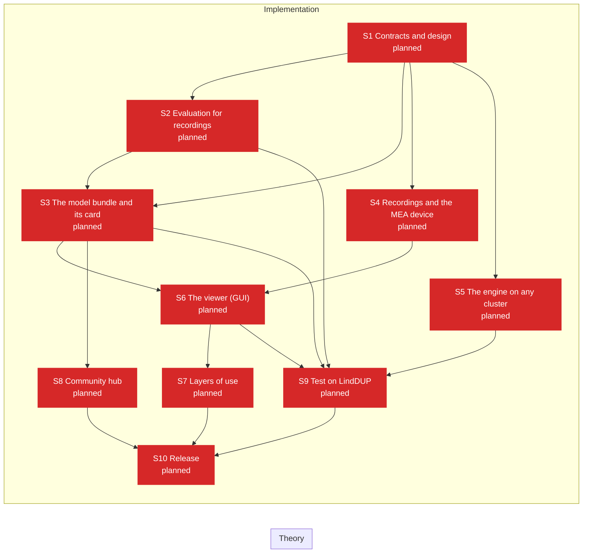

# Roadmap -- The tool: the engine, the model bundle and its card, the viewer (D-157)

Generated by `specs/roadmap/roadmap.py render` from `specs/roadmap/tool.yaml`; do not edit. Branch `sci/tool` at `23c17ad` (2026-11-18); synced 2026-11-23T13:53:32+00:00 from chat.

## Legend

| State | Colour | Meaning |
|---|---|---|
| planned (implementation) | #d62828 | not implemented |
| local (implementation) | #f77f00 | implemented, not pushed |
| pushed (implementation) | #e9c46a | pushed, not tested |
| testing (implementation) | #3a86ff | independent tester running |
| tested (implementation) | #2a9d8f | tester passed, HPC run missing |
| running (implementation) | #8338ec | HPC job running |
| failing (implementation) | #b5174e | tester or HPC failure on the current code |
| done (implementation) | #2d9a3d | pushed, tested, HPC run done |
| open (theory) | #8d99ae | not started |
| studying (theory) | #3a86ff | being studied |
| closed (theory) | #2d9a3d | closed |

A dashed border marks a stage whose dependency is not in place (a block that is planned, local or failing; a topic not closed). Theory and implementation progress independently: the dotted edges between them are links, not conditions. REVISE marks a stage that has to change because of a decision taken on the other side.

## Theory

| Stage | Group | Status | Closed | Decision | Depends on | Linked blocks | Revise | Summary |
|---|---|---|---|---|---|---|---|---|

## Implementation

| Stage | Group | Blocks | Status | Why | Last change | Tester | HPC | Depends on | Theory (open) | Revise | Summary |
|---|---|---|---|---|---|---|---|---|---|---|---|
| S1 Contracts and design |  |  | planned | step of the plan: no blocks defined yet (roadmap.py add block ... --parent S1) |  |  |  |  |  |  | The tool's specification: the model bundle, and four plug-in contracts (the bank format a simulator writes, the recording adapter, the simulator at a given theta, the scheduler). |
| S2 Evaluation for recordings |  |  | planned | step of the plan: no blocks defined yet (roadmap.py add block ... --parent S2) |  |  |  | S1 |  |  | For any recorded project: the posteriors on the real windows; the calibration on its held-out simulations, with contraction and the edge rows apart; the per-window gate; the predictive check through the project's own simulator, per member; the report and its figures. Built in two waves: everything but the predictive check first. |
| S3 The model bundle and its card |  |  | planned | step of the plan: no blocks defined yet (roadmap.py add block ... --parent S3) |  |  |  | S1, S2 |  |  | A trained ensemble as one self-contained, safely loadable package (weights, architecture, prior box with axis names and units, extraction parameters, held-out evaluation, reference embeddings) and its card: a predefined file the author fills, checked by a validator. |
| S4 Recordings and the MEA device |  |  | planned | step of the plan: no blocks defined yet (roadmap.py add block ... --parent S4) |  |  |  | S1 |  |  | Recording adapters, the device layout, and the extraction configuration turned into subregions and windows, runnable on a laptop. |
| S5 The engine on any cluster |  |  | planned | step of the plan: no blocks defined yet (roadmap.py add block ... --parent S5) |  |  |  | S1 |  |  | The non-GUI command line; one scheduler interface with several back ends; a setup probe that finds the scheduler, the queues and the environment tools, runs a test job and writes a site profile the user can edit. |
| S6 The viewer (GUI) |  |  | planned | step of the plan: no blocks defined yet (roadmap.py add block ... --parent S6) |  |  |  | S3, S4 |  |  | Load a bundle and recordings, get posteriors with the three checks. Views: the device with its electrodes and the chosen subregions, traces and windows, posteriors, checks, wells and conditions compared. |
| S7 Layers of use |  |  | planned | step of the plan: no blocks defined yet (roadmap.py add block ... --parent S7) |  |  |  | S6 |  |  | Guided, standard and expert modes; plain and formal explanations inside the interface; presets, a glossary, tutorials, an example data set and an example bundle. |
| S8 Community hub |  |  | planned | step of the plan: no blocks defined yet (roadmap.py add block ... --parent S8) |  |  |  | S3 |  |  | Where bundles are shared: submission with the mandatory card, automatic validation, versions, licence and citation; browsing from the viewer. |
| S9 Test on LindDUP |  |  | planned | step of the plan: no blocks defined yet (roadmap.py add block ... --parent S9) |  |  |  | S2, S3, S5, S6 |  |  | The whole chain end to end on LindDUP's best fits (evaluation, bundle, viewer): LindDUP is the test of the tool, not its design target. |
| S10 Release |  |  | planned | step of the plan: no blocks defined yet (roadmap.py add block ... --parent S10) |  |  |  | S7, S8, S9 |  |  | Installable packages, a licence, continuous integration, the documentation and the final audit. |

